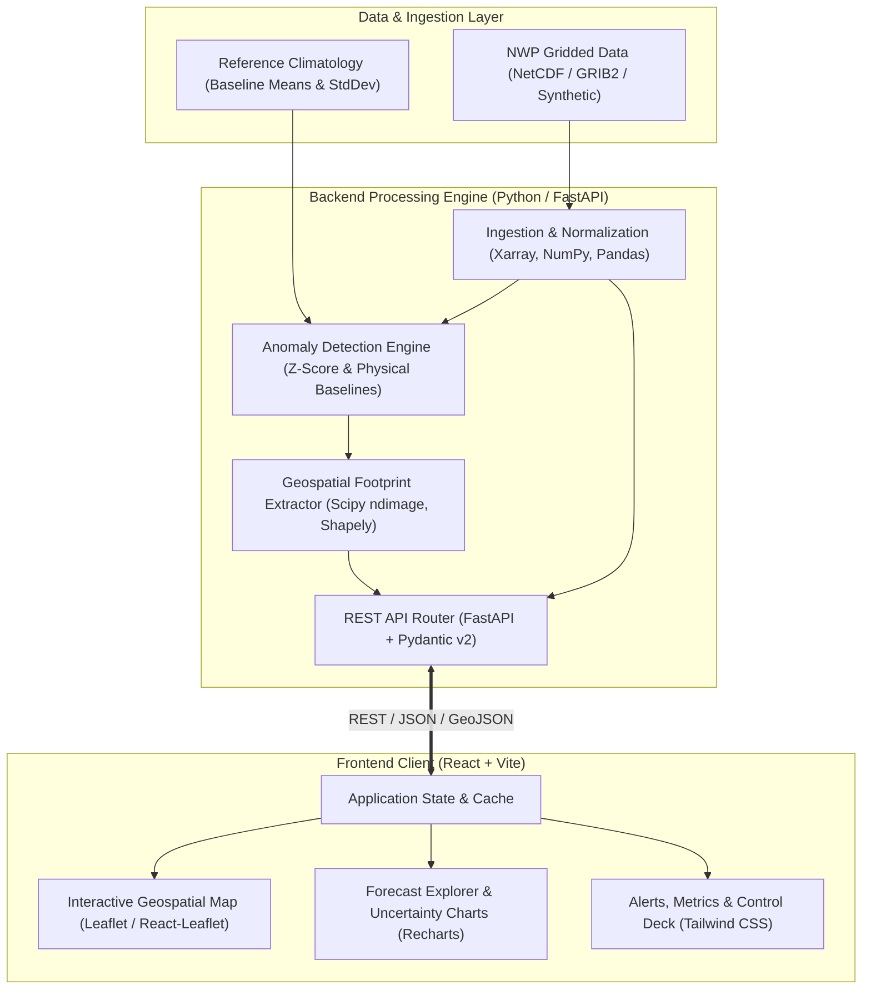

# AeroNex: AI-Powered Weather Intelligence & Extreme Weather Anomaly Detection

[](https://sih.gov.in)
[]()
[-success.svg)]()
[-success.svg)]()
[-success.svg)]()
[](file:///d:/msi/SIH_26078/docs/RENDER_DEPLOYMENT.md)
[](file:///d:/msi/SIH_26078/docs/)

> **AeroNex** is an open, modular meteorological intelligence platform designed to ingest Numerical Weather Prediction (NWP) forecasts, systematically detect spatiotemporal weather anomalies (cyclones, heat domes, cold waves, pressure anomalies), compute their precise geographic footprints, and visualize forecast dynamics alongside quantifiable forecast uncertainty.

---

## 1. Project Overview & Context

Extreme weather events inflict catastrophic economic losses and threaten human life across the globe, with vulnerable regions like the Indian subcontinent experiencing heightened frequencies of severe tropical cyclones, deadly heatwaves, and erratic monsoon depressions. Modern Numerical Weather Prediction (NWP) models (e.g., GFS, ECMWF IFS, NCMRWF) produce tens of gigabytes of gridded multidimensional data every cycle.

However, operational meteorologists, disaster management authorities (NDRF/SDMA), and regional planners face critical bottlenecks:
1. **Data Overload & Manual Interpretation**: Identifying the exact boundary, severity, and trajectory of an emerging anomaly within terabytes of raw multidimensional arrays requires specialized scientific software and manual visual inspection.
2. **Medium-Range Forecast Uncertainty**: As lead time expands from 3 to 10 days, atmospheric chaos drastically inflates forecast spread. Most visual tools display deterministic outputs without communicating confidence levels or ensemble variance.
3. **Delayed Actionable Intelligence**: Disaster responders need immediate, polygon-bounded geographic footprints (GeoJSON) with severity indices, not just raw raster heatmaps.

**AeroNex** bridges this gap by coupling scientific numerical processing with statistical anomaly detection algorithms and modern geospatial web interfaces.

---

## 2. Core Objectives

* **Automated Anomaly Detection**: Rapidly scan multi-variable gridded weather forecasts (temperature, wind velocity, mean sea-level pressure) using climatological z-scores and physical threshold algorithms.
* **Geographic Footprint Extraction**: Convert contiguous clusters of anomalous grid cells into geospatial vector polygons (GeoJSON) with bounding boxes, geometric centroids, and estimated surface areas ($km^2$).
* **Forecast Evolution & Horizon Exploration**: Provide multi-timestep tracking across 1-day to 10-day forecast horizons to observe whether anomalies intensify, disperse, or shift geographically.
* **Uncertainty & Ensemble Communication**: Visualize forecast spread, model agreement, and missing-data margins to prevent false confidence in long-lead predictions.
* **Open, Extensible Architecture**: Deliver an accessible web-based dashboard backed by a high-performance Python scientific API, ready for both simulated hackathon demonstrations and real-world GFS/ECMWF integration.

> [!IMPORTANT]
> **Scientific Integrity Notice**: AeroNex does not claim to generate new physical weather forecasts or improve the intrinsic numerical accuracy of government NWP models. AeroNex is an **analytical and post-processing intelligence layer** that extracts, flags, bounds, and explains anomalies embedded within upstream model forecasts.

---

## 3. System Architecture & Technology Stack

AeroNex follows a decoupled, service-oriented architecture designed for scientific computing and responsive geospatial web visualization:



### Technology Matrix

| Layer | Primary Technology | Rationale & Purpose |
| :--- | :--- | :--- |
| **Frontend Framework** | **React 18+ (Vite)** | Blazing fast build pipeline, declarative UI component model. |
| **Styling & Design** | **Tailwind CSS** | Custom dark scientific palette (Slate/Navy with Cyan/Amber accents). |
| **Geospatial Mapping** | **Leaflet / React-Leaflet** | Lightweight, high-performance GeoJSON polygon & vector layer rendering. |
| **Data Visualization** | **Recharts** | Declarative time-series forecast envelopes and uncertainty bands. |
| **Backend REST API** | **FastAPI (Python 3.11+)** | High-throughput asynchronous Python framework with automatic OpenAPI docs. |
| **Data Validation** | **Pydantic v2** | Strict typing and serialization for meteorological parameters and GeoJSON. |
| **Scientific Processing** | **NumPy, Pandas, Xarray** | Multidimensional gridded array manipulation, slicing, and netCDF/GRIB handling. |
| **Spatial Algorithms** | **SciPy (ndimage), Shapely** | Connected component labeling, polygonization, centroid & area calculations. |
| **Storage Architecture** | **In-Memory / JSON / NetCDF** | Stage 1 prototype storage with seamless migration path to PostgreSQL/PostGIS. |

---

## 4. Project Documentation Directory

Detailed implementation specifications have been compiled in the [`docs/`](file:///d:/msi/SIH_26078/docs/) directory:

1. [**docs/PROJECT_REQUIREMENTS.md**](file:///d:/msi/SIH_26078/docs/PROJECT_REQUIREMENTS.md): Complete functional and non-functional requirements, user personas, operational constraints, and acceptance criteria.
2. [**docs/SYSTEM_ARCHITECTURE.md**](file:///d:/msi/SIH_26078/docs/SYSTEM_ARCHITECTURE.md): Component interactions, data flow sequences, state management, storage schemas, and deployment architecture.
3. [**docs/DATA_STRATEGY.md**](file:///d:/msi/SIH_26078/docs/DATA_STRATEGY.md): Two-stage data ingestion (Synthetic Prototype vs. Real NOAA GFS/ECMWF), scientific data dictionary, and coordinate/unit conventions.
4. [**docs/ANOMALY_DETECTION.md**](file:///d:/msi/SIH_26078/docs/ANOMALY_DETECTION.md): Mathematical formulations for z-scores, physical threshold logic, connected-component spatial clustering, and uncertainty boundaries.
5. [**docs/API_SPECIFICATION.md**](file:///d:/msi/SIH_26078/docs/API_SPECIFICATION.md): Complete OpenAPI-style endpoint contracts, query parameters, error responses (RFC 7807), and sample payloads.
6. [**docs/UI_UX_SPECIFICATION.md**](file:///d:/msi/SIH_26078/docs/UI_UX_SPECIFICATION.md): Design system tokens, component hierarchies, wireframe layouts, time scrubber controls, and responsive states.
7. [**docs/TESTING_AND_VALIDATION.md**](file:///d:/msi/SIH_26078/docs/TESTING_AND_VALIDATION.md): Unit, integration, geospatial edge-case, and scientific plausibility test suites with explicit evaluation metrics.
8. [**docs/DEVELOPMENT_ROADMAP.md**](file:///d:/msi/SIH_26078/docs/DEVELOPMENT_ROADMAP.md): 9-phase milestone execution plan, task breakdown, risk management, and demo deliverables for Smart India Hackathon.
9. [**docs/SIH_DEMO_RUNBOOK.md**](file:///d:/msi/SIH_26078/docs/SIH_DEMO_RUNBOOK.md): 3–5 minute step-by-step presentation script, click-by-click jury walkthrough, and contingency fallbacks.
10. [**docs/INTEGRATION_REPORT.md**](file:///d:/msi/SIH_26078/docs/INTEGRATION_REPORT.md): Complete end-to-end integration architecture, API route inventory, verified workflows, and automated test results.
11. [**docs/KNOWN_LIMITATIONS.md**](file:///d:/msi/SIH_26078/docs/KNOWN_LIMITATIONS.md): Rigorous taxonomy of implemented, experimental, demo-only, and planned capabilities.
12. [**docs/FINAL_QA_REPORT.md**](file:///d:/msi/SIH_26078/docs/FINAL_QA_REPORT.md): Comprehensive Phase 8 QA audit, bug fixes, 156 pytest results, and 15-step SIH flow verification.
13. [**docs/SCIENTIFIC_LIMITATIONS.md**](file:///d:/msi/SIH_26078/docs/SCIENTIFIC_LIMITATIONS.md): Transparent scientific analysis of domain boundaries, 0.25° grid limits, physical thresholds vs. climatology, and non-probabilistic scoring.
14. [**docs/SIH_FINAL_PRESENTATION_GUIDE.md**](file:///d:/msi/SIH_26078/docs/SIH_FINAL_PRESENTATION_GUIDE.md): Final presentation script, technical explanations, honest innovation statement, 10 jury Q&As, and live demo fallback runbook.
15. [**docs/RENDER_DEPLOYMENT.md**](file:///d:/msi/SIH_26078/docs/RENDER_DEPLOYMENT.md): Complete Render Blueprint deployment instructions, environment variables, and CDN architecture.

---

## 5. Directory Structure Blueprint

The target implementation structure for the AeroNex platform is organized as follows:

```text
SIH_26078/
├── README.md                           # Main Project Overview & Index
├── docs/                               # Engineering & Architectural Specifications
│   ├── PROJECT_REQUIREMENTS.md         # Requirements, Personas & Constraints
│   ├── SYSTEM_ARCHITECTURE.md          # Architecture, Services & Dataflow
│   ├── DATA_STRATEGY.md                # Data Pipeline, Data Dictionary & Ingestion
│   ├── ANOMALY_DETECTION.md            # Scientific Methodology & Spatial Algorithms
│   ├── API_SPECIFICATION.md            # REST API Contract & Payloads
│   ├── UI_UX_SPECIFICATION.md          # Design System, Screens & Layouts
│   ├── TESTING_AND_VALIDATION.md       # Test Strategy & Scientific Plausibility
│   └── DEVELOPMENT_ROADMAP.md          # 9-Phase Implementation Schedule
├── backend/                            # FastAPI Application (Planned Phase 3)
│   ├── app/
│   │   ├── api/                        # Route Handlers (/overview, /forecasts, etc.)
│   │   ├── core/                       # Configuration, Logging, Constants
│   │   ├── models/                     # Pydantic Schemas & Domain Models
│   │   └── services/                   # Processing, Detection & Footprint Logic
│   ├── data/                           # Sample & Baseline NetCDF/JSON Datasets
│   ├── tests/                          # Backend Unit & Integration Tests
│   └── requirements.txt
└── frontend/                           # React + Vite Application (Planned Phase 2)
    ├── public/                         # Static Assets & Base Map Icons
    ├── src/
    │   ├── assets/                     # Styles, Brand Logos & Color Tokens
    │   ├── components/                 # Map, Header, Sidebar, Charts & Sliders
    │   ├── hooks/                      # Custom React Hooks (useForecast, useMapLayers)
    │   ├── pages/                      # Dashboard, MapExplorer, EventDetails
    │   ├── services/                   # Axios/Fetch API Clients
    │   └── utils/                      # GeoJSON Utilities & Unit Formatters
    ├── package.json
    └── vite.config.js
```

---

## 6. Frontend Dashboard Setup & Running Instructions

The React 18 + Vite frontend dashboard has been implemented in `frontend/` matching the visual design reference.

### 6.1 Prerequisites
* **Node.js**: v18+ (tested with v24.19.0)
* **npm**: v9+ (tested with 11.17.0)

### 6.2 Running Locally
```powershell
# Navigate to the frontend directory
cd frontend

# Install dependencies (if not already installed)
npm.cmd install

# Start the Vite development server
npm.cmd run dev
```
The application will be accessible at `http://localhost:5173/`.

### 6.3 Building for Production
```powershell
cd frontend
npm.cmd run build
```

---

## 7. Implemented Components & Dashboard Features

* **[AppLayout](file:///d:/msi/SIH_26078/frontend/src/components/layout/AppLayout.jsx)**: Persistent responsive navigation shell with sidebar, top status header, search filter, and mobile drawer.
* **[Sidebar](file:///d:/msi/SIH_26078/frontend/src/components/layout/Sidebar.jsx)**: AeroNex branding, active route indicators, view transitions, and photorealistic glowing Earth graphic (`Better Insights. Safer Tomorrows.`).
* **[TopHeader](file:///d:/msi/SIH_26078/frontend/src/components/layout/TopHeader.jsx)**: Autocomplete anomaly search bar, UTC timestamp, `DEMO DATA` provenance tag, system alerts notification dropdown, and user profile pill.
* **[StatCard](file:///d:/msi/SIH_26078/frontend/src/components/dashboard/StatCard.jsx)**: 4 executive KPI cards (Active Anomalies, Regions Monitored, Forecast Horizon, Latest Data) with glows and trend indicators.
* **[WeatherMap](file:///d:/msi/SIH_26078/frontend/src/components/map/WeatherMap.jsx)**: Global Leaflet dark matter map featuring layer toggles (Temperature Anomaly, Wind 850 hPa, Pressure MSLP, Precipitation, Footprints, Forecast Track), vector polygons, radar pulses, camera auto-centering, and zoom/crosshair controls.
* **[MapLegend](file:///d:/msi/SIH_26078/frontend/src/components/map/MapLegend.jsx)**: Continuous temperature anomaly color ramp (-10°C to +10°C).
* **[ForecastControls](file:///d:/msi/SIH_26078/frontend/src/components/map/ForecastControls.jsx)**: Interactive 10-day time scrubber with automated Play/Pause animation.
* **[RecentAlerts](file:///d:/msi/SIH_26078/frontend/src/components/dashboard/RecentAlerts.jsx)**: Right-hand interactive alerts list with category icons, severity badges, and synchronized selection states.
* **[EventDetails](file:///d:/msi/SIH_26078/frontend/src/components/dashboard/EventDetails.jsx)**: Telemetry panel displaying selected event coordinates, forecast window, estimated area ($km^2$), max wind, central pressure, and "View Full Details" trigger.
* **[ForecastChart](file:///d:/msi/SIH_26078/frontend/src/components/dashboard/ForecastChart.jsx)**: 10-day multi-line Recharts graph with variable switcher tabs (Temperature, Wind, Pressure, Precipitation).
* **[SeverityChart](file:///d:/msi/SIH_26078/frontend/src/components/dashboard/SeverityChart.jsx)**: Donut distribution chart with center count (5 Total) and High/Medium/Low percentage breakdowns.
* **[AnomalyTypeBreakdown](file:///d:/msi/SIH_26078/frontend/src/components/dashboard/AnomalyTypeBreakdown.jsx)**: Categorical progress bars for Cyclone, Heat Wave, Cold Wave, Wind Anomaly, and Pressure Anomaly.
* **[EventDetailModal](file:///d:/msi/SIH_26078/frontend/src/components/dashboard/EventDetailModal.jsx)**: In-depth diagnostic modal with synopsis, metrics grid, and decision support advice.
* **[Centralized Demo Data](file:///d:/msi/SIH_26078/frontend/src/data/demoData.js)**: Single source of truth for all statistics, anomalies, geometries, and time-series.

---

## 8. FastAPI Backend Setup & Running Instructions

The Python FastAPI backend has been implemented in `backend/` providing REST endpoints, Pydantic v2 schemas, and RFC 7946 GeoJSON map features.

### 8.1 Prerequisites
* **Python**: 3.11+ (tested with CPython 3.12.14)
* **Package Manager**: `uv` or standard Python `venv`

### 8.2 Starting the Backend
```powershell
# Navigate to backend directory
cd backend

# Create virtual environment (Python 3.12)
uv venv .venv --python 3.12

# Install dependencies
uv pip install -r requirements.txt --python .venv/Scripts/python.exe

# Start the Uvicorn ASGI server
.\.venv\Scripts\python.exe -m uvicorn app.main:app --host 0.0.0.0 --port 8000 --reload
```
The API is available at `http://localhost:8000/`.  
Interactive Swagger documentation is available at **`http://localhost:8000/docs`**.

### 8.3 Running Backend Automated Tests
```powershell
cd backend
.\.venv\Scripts\pytest.exe tests/ -v -s
```
*(Verified: **156 automated tests** across 25 suites covering all REST endpoints, coordinate validation, canonical unit conversion, individual variable anomaly detectors, connected-component clustering, spherical cosine-latitude area integration, GeoJSON polygonization, empirical validation against injected synthetic ground truth, CF-1.8 NetCDF4 parsing, GRIB2 header ingestion, physics validation bounds, live NOAA NOMADS filter retrieval, geodesic Haversine distance, forward azimuth bearing, translation speed, missing-frame preservation, ensemble spread metrics, deterministic Lyapunov skill decay fallback, and complete Phase 7 end-to-end integration workflows).*

### 8.4 Ingestion Endpoints (Phase 5)
* `GET /api/datasets`: Discovers and enumerates available local and cached NWP datasets.
* `GET /api/datasets/{dataset_id}`: Retrieves comprehensive dataset metadata, variables, and dimensions.
* `POST /api/ingestion/validate`: Dry-run validation of a target NWP dataset against physics bounds.
* `POST /api/ingestion/run`: Executes the end-to-end ingestion and optional anomaly detection pipeline.
* `GET /api/ingestion/status`: Real-time ingestion engine status and active data provenance.

### 8.5 Tracking & Forecast Uncertainty Endpoints (Phase 6)
* `GET /api/events/tracks`: Summaries of all multi-horizon tracked anomaly series across forecast frames.
* `GET /api/events/tracks/{track_id}`: Detailed track profile, net displacement, speed, and caveats.
* `GET /api/events/tracks/{track_id}/history`: Chronological sequence of `TrackPoint` detections (Days 1–10).
* `GET /api/uncertainty`: System-wide uncertainty mode, active member count, and 10-day decay guide.
* `GET /api/uncertainty/{event_id}`: Event-specific uncertainty analysis (ensemble metrics or deterministic caveats).

---

## 9. Current Prototype Status & Roadmap

* **Phase 1: Architecture & Technical Documentation**: **COMPLETED**
* **Phase 2: UI Foundation & Frontend Dashboard**: **COMPLETED**
* **Phase 3: FastAPI Backend & Data Schemas**: **COMPLETED**
* **Phase 4: Weather Anomaly Detection & Geospatial Footprint Engine**: **COMPLETED**
* **Phase 5: Operational NWP Ingestion (NOAA GFS / NOMADS Open Data & NetCDF4)**: **COMPLETED**
* **Phase 6: Medium-Range Forecast Tracking & Temporal Uncertainty**: **COMPLETED**
* **Phase 7: End-to-End System Integration & SIH Demo Readiness**: **COMPLETED**
* **Phase 8: Final QA, Optimization & SIH Presentation Readiness**: **COMPLETED**
* **Phase 9: Automated Live Ingestion Daemon & High-Resolution Operational Deployment (Post-Hackathon)**: **PLANNED**

> [!NOTE]
> **Scientific Integrity & Provenance Mode**: AeroNex transparently flags all data sources. In demo fallback mode, records are tagged `DEMO_SYNTHETIC_DATASET` (`is_simulated: true`). When real NWP forecast files are ingested, records are tagged `REAL_NOAA_GFS` or `LOCAL_NWP_NETCDF` (`is_real_data: true`), with complete physical units, coordinate bounds, and validation telemetry preserved. Single deterministic runs provide rigorous Lyapunov lead-time skill decay bands without fabricating artificial ensemble spread. Baseline thresholds represent interpretable extreme-condition candidate detectors.

