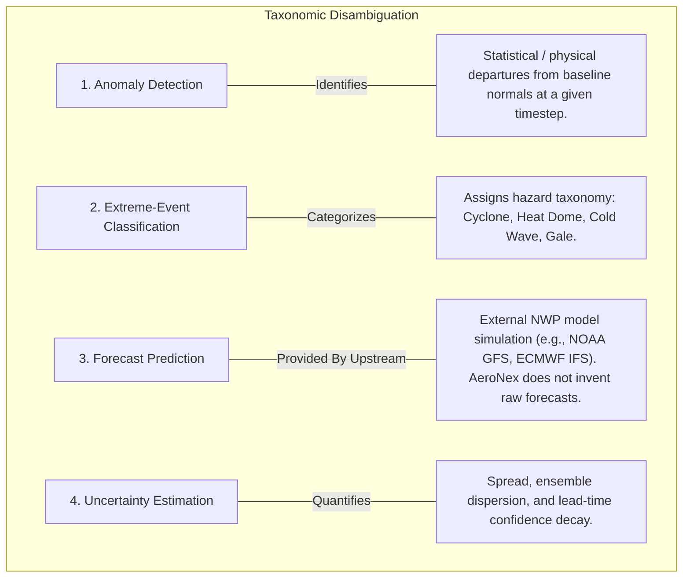
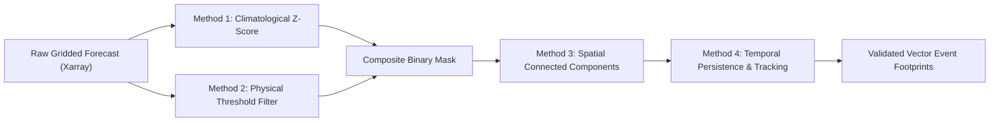
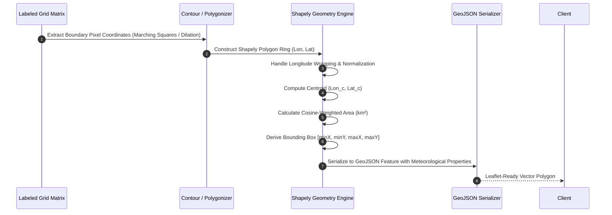
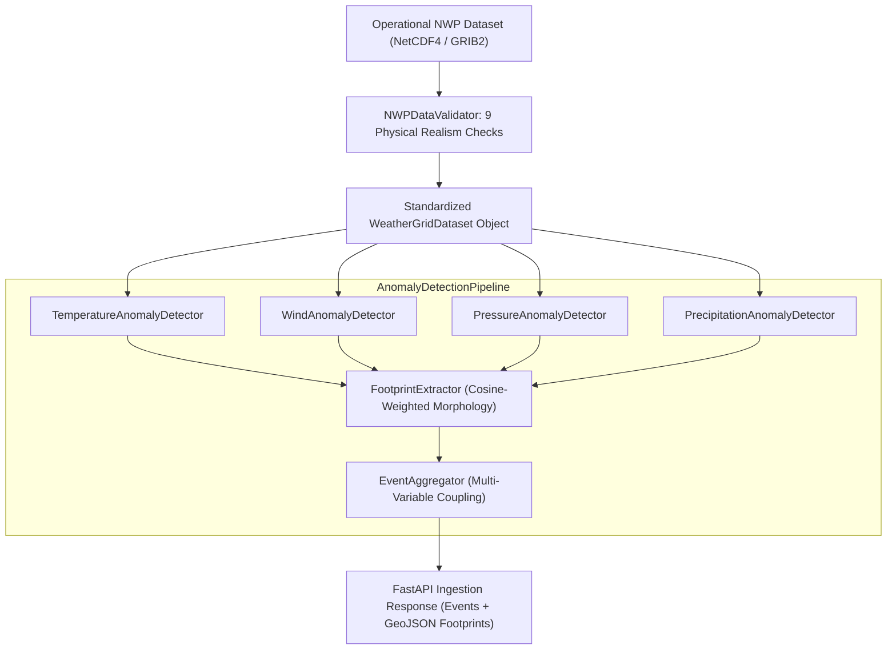

# AeroNex: Anomaly Detection & Geospatial Footprint Methodology

[]()
[]()
[]()

This document formalizes the scientific and algorithmic foundations of **AeroNex**. It establishes interpretable baselines for extreme weather anomaly detection, details the spatial clustering and footprint polygonization pipeline, and clarifies the boundary between statistical anomaly detection, deterministic prediction, and future machine learning enhancements.

---

## 1. Conceptual Framework & Taxonomical Disambiguation

To preserve scientific rigor, AeroNex maintains strict taxonomic distinctions between core meteorological concepts:



> [!IMPORTANT]
> **Scientific Integrity Rule**: AeroNex's baseline thresholding and climatological $Z$-score formulations are **rigorous statistical and physical algorithms**, not "trained deep learning models." Advanced machine learning (e.g., PyTorch spatiotemporal U-Nets or Autoencoders) represents a scheduled future research milestone and is not presented as the operational baseline.

---

## 2. Baseline Anomaly Detection Methods

AeroNex implements four complementary, interpretable detection mechanisms:



---

### Method 1: Climatological Standard Score ($Z$-Score) Departure

#### Objective & Principle
Measures the local rarity of a weather variable relative to the long-term historical mean and standard deviation for that specific location and calendar day.

#### Mathematical Formulation
For a gridded variable $X(t, \phi, \lambda)$ at valid time $t$, latitude $\phi$, and longitude $\lambda$:
$$Z(t, \phi, \lambda) = \frac{X(t, \phi, \lambda) - \mu_{clim}(d, \phi, \lambda)}{\sigma_{clim}(d, \phi, \lambda)}$$
Where:
* $X(t, \phi, \lambda)$ is the forecasted meteorological parameter value (e.g., $T_{2m}$, $MSLP$).
* $\mu_{clim}(d, \phi, \lambda)$ is the 30-year climatological mean for day of year $d \in [1, 366]$.
* $\sigma_{clim}(d, \phi, \lambda)$ is the climatological standard deviation for day of year $d$.

#### Logical Rule & Output
$$\text{Mask}_{Z}(t, \phi, \lambda) = \begin{cases} 
1 & \text{if } |Z(t, \phi, \lambda)| \ge Z_{threshold} \\
0 & \text{otherwise}
\end{cases}$$

#### Parameter Specifications
* `Z_threshold` (Default: $2.5\sigma$ for moderate anomalies; $3.0\sigma$ for extreme/unprecedented events).
* `climatology_window`: 15-day centered rolling window across historical baseline years (e.g., 1991–2020 normal).

#### Advantages & Limitations
* **Advantages**: Normalized across diverse climatic zones (e.g., a $40^\circ C$ temperature is normal in the Thar desert in June, but an extreme anomaly in the Western Ghats).
* **Limitations**: Requires high-quality, pre-computed 30-year reanalysis climatology (e.g., ERA5); assumes Gaussian distribution, which may underrepresent heavy-tailed distributions (e.g., precipitation).

---

### Method 2: Configurable Physical & Percentile Thresholds

#### Objective & Principle
Directly flags hazardous meteorological conditions defined by established meteorological classification standards (e.g., IMD, WMO criteria).

#### Mathematical & Logical Rules
* **Severe Cyclonic Depression / Storm**:
  $$\text{Mask}_{cyclone}(t, \phi, \lambda) = \left( MSLP(t, \phi, \lambda) \le 992\ hPa \right) \land \left( WS_{10}(t, \phi, \lambda) \ge 17.5\ m/s \right)$$
* **Extreme Heat Dome / Heatwave**:
  $$\text{Mask}_{heat}(t, \phi, \lambda) = \left( T_{2m}(t, \phi, \lambda) \ge 40.0^\circ C \right) \lor \left( T_{2m}(t, \phi, \lambda) \ge P_{95}(\phi, \lambda) \right)$$
* **Cold Air Outbreak / Severe Cold Wave**:
  $$\text{Mask}_{cold}(t, \phi, \lambda) = \left( T_{2m}(t, \phi, \lambda) \le 4.0^\circ C \right) \land \left( Z_{T}(t, \phi, \lambda) \le -2.0 \right)$$
* **Gale-Force Wind Squall**:
  $$\text{Mask}_{wind}(t, \phi, \lambda) = WS_{10}(t, \phi, \lambda) \ge 20.8\ m/s\ (\approx 75\ km/h)$$

#### Parameter Specifications
* User-configurable via API query parameters: `threshold_val`, `min_wind_speed`, `max_pressure`.

#### Advantages & Limitations
* **Advantages**: Direct mapping to real-world emergency advisory thresholds; zero reliance on climatological pre-processing.
* **Limitations**: Fails to adjust for elevation (e.g., high-altitude plateaus naturally possess low $MSLP$ unless reduced to sea level).

---

### Method 3: Spatial Connected-Component Grouping

#### Objective & Principle
Aggregates individual 2D anomalous boolean cells into cohesive, bounded spatial weather systems, simultaneously filtering out isolated single-pixel noise.

#### Algorithm Specification
1. Let $M \in \{0, 1\}^{N_{lat} \times N_{lon}}$ be the composite binary anomaly mask.
2. Apply 8-connectivity structural element $S$:
   $$S = \begin{bmatrix} 1 & 1 & 1 \\ 1 & 1 & 1 \\ 1 & 1 & 1 \end{bmatrix}$$
3. Perform morphological connected-component labeling:
   $$L = \text{label}(M, \text{structure}=S)$$
4. For each labeled cluster $k \in [1, K]$:
   * Calculate cell count: $N_k = \sum_{i,j} [L_{i,j} == k]$.
   * Calculate physical surface area ($km^2$) with cosine latitude correction:
     $$\text{Area}_k = \sum_{(i,j) \in k} R_E^2 \cdot \cos(\phi_i) \cdot \Delta\phi \cdot \Delta\lambda$$
   * Filter noise: Discard cluster $k$ if $\text{Area}_k < \text{Area}_{min}$ (Default: $2,500\ km^2$).

#### Advantages & Limitations
* **Advantages**: Converts fragmented gridded matrices into discrete, indexable geographic entities with well-defined physical bounds.
* **Limitations**: Large synoptic systems separated by a single non-anomalous grid cell may be split into two separate entities (mitigated by binary morphological dilation before labeling).

---

### Method 4: Temporal Persistence & Trajectory Tracking

#### Objective & Principle
Correlates anomaly clusters across successive forecast timesteps ($T_0, T_1, \dots, T_n$) to confirm whether an anomaly exhibits temporal persistence and track its movement trajectory.

#### Algorithmic Logic
For a cluster $C_a$ at timestep $t$ and a cluster $C_b$ at timestep $t + \Delta t$:
1. Compute Intersection over Union ($\text{IoU}$):
   $$\text{IoU}(C_a, C_b) = \frac{\text{Area}(C_a \cap C_b)}{\text{Area}(C_a \cup C_b)}$$
2. If $\text{IoU}(C_a, C_b) \ge \tau_{IoU}$ (e.g., $0.20$) OR centroid displacement $D(\text{centroid}_a, \text{centroid}_b) \le V_{max} \cdot \Delta t$:
   * Assign matching `event_id`.
   * Record trajectory vector and velocity.
3. Transient anomalies lasting only a single 3-hour timestep are flagged as `TRANSIENT_CONVECTIVE_NOISE`.

---

## 3. Geographic Footprint Extraction Pipeline

The extraction pipeline transforms labeled clusters into geospatial vectors ready for map rendering:



### Steps in the Pipeline:
1. **Binary Boundary Extraction**: Compute boundary coordinates of the contiguous cluster.
2. **Polygon Construction**: Wrap vertices into a closed linear ring `Shapely.geometry.Polygon`.
3. **Geometry Simplification**: Apply the Douglas-Peucker algorithm ($\epsilon = 0.05^\circ$) to reduce vertex count for efficient web delivery while preserving meteorological shape.
4. **Centroid & Area Evaluation**:
   * Centroid: $\bar{\phi} = \frac{1}{N}\sum \phi_i$, $\bar{\lambda} = \frac{1}{N}\sum \lambda_i$.
   * Area: Cosine-weighted spherical integration.
5. **GeoJSON Feature Packaging**:
   ```json
   {
     "type": "Feature",
     "geometry": {
       "type": "Polygon",
       "coordinates": [[[85.2, 18.4], [87.6, 18.5], [88.1, 20.2], [85.5, 20.1], [85.2, 18.4]]]
     },
     "properties": {
       "event_id": "CYC-202410-001",
       "hazard_type": "CYCLONIC_DEPRESSION",
       "severity": "EXTREME",
       "area_km2": 48210.5,
       "centroid": [86.6, 19.3],
       "max_wind_ms": 36.4,
       "min_mslp_hpa": 974.2
     }
   }
   ```

---

## 4. Anomaly Severity Classification Index

AeroNex scores each anomaly entity into a 4-tier severity index based on peak intensity and spatial impact:

| Severity Level | Color Code | Criteria (Cyclone) | Criteria (Heat Dome) | Criteria (Cold Wave) | Action Advisory |
| :--- | :--- | :--- | :--- | :--- | :--- |
| **Advisory** (Level 1) | `#FBBF24` (Yellow) | $MSLP \le 1000\ hPa$, $WS \ge 14\ m/s$ | $Z_{T} \ge 2.0\sigma$, $T \ge 38^\circ C$ | $Z_{T} \le -2.0\sigma$, $T \le 8^\circ C$ | Routine meteorological monitoring. |
| **Moderate** (Level 2) | `#F97316` (Orange) | $MSLP \le 992\ hPa$, $WS \ge 17.5\ m/s$ | $Z_{T} \ge 2.5\sigma$, $T \ge 41^\circ C$ | $Z_{T} \le -2.5\sigma$, $T \le 5^\circ C$ | Heightened preparedness for regional authorities. |
| **Severe** (Level 3) | `#EF4444` (Red) | $MSLP \le 982\ hPa$, $WS \ge 24.5\ m/s$ | $Z_{T} \ge 3.0\sigma$, $T \ge 44^\circ C$ | $Z_{T} \le -3.0\sigma$, $T \le 2^\circ C$ | Emergency disaster response pre-positioning. |
| **Extreme** (Level 4) | `#991B1B` (Crimson) | $MSLP \le 970\ hPa$, $WS \ge 32.7\ m/s$ | $Z_{T} \ge 3.5\sigma$, $T \ge 46^\circ C$ | $Z_{T} \le -3.5\sigma$, $T \le 0^\circ C$ | Critical life-safety evacuations & red alert. |

---

## 5. Forecast Uncertainty & Ensemble Dispersion

Forecast reliability inherently degrades with increasing lead time:

$$\sigma_{forecast}(t) \propto \sigma_0 \cdot e^{\lambda t}$$
Where $\lambda$ is the atmospheric Lyapunov exponent.

### Communicating Uncertainty in AeroNex:
1. **Forecast Horizon Bands**:
   * **Days 1–3 ($0–72h$)**: *High Confidence* (Deterministic NWP model skill is strong; tight spread).
   * **Days 4–6 ($72–144h$)**: *Moderate Confidence* (Emergence of track and intensity divergence).
   * **Days 7–10 ($144–240h$)**: *Low / Trend-Only Confidence* (Ensemble spread is high; footprints indicate potential probabilistic threats rather than precise landfall coordinates).
2. **Visual Uncertainty Envelopes**:
   * Recharts visualizes the 10th to 90th percentile ensemble envelope around the deterministic mean forecast curve.
   * Polygons on Days 7–10 are rendered with dashed borders and higher transparency fill to intuitively communicate uncertainty to the user.

---

## 6. Advanced Machine Learning Roadmap (Future Enhancement)

Following the hackathon prototype baseline, the platform roadmap specifies two advanced ML models for experimental evaluation:

1. **Spatiotemporal 3D Convolutional Autoencoder (PyTorch)**:
   * *Architecture*: Unsupervised encoder-decoder trained on 30 years of ERA5 reanalysis fields to reconstruct "normal" atmospheric patterns.
   * *Inference*: Extreme events produce high reconstruction error (Mean Squared Error per pixel), providing a non-linear, multi-variable anomaly index without manual thresholding.
2. **Graph Neural Network (GNN) for Track Prediction**:
   * *Architecture*: Nodes representing anomaly centroids across consecutive timesteps connected via spatiotemporal edges to forecast future trajectory vectors under ensemble uncertainty.

---

## 7. Phase 4 Implementation Details & Empirical Benchmark Results

### A. Implemented Engine Architecture
The Phase 4 engine is organized into modular, testable scientific components:
* `GridPreprocessor` (`app/engine/preprocessor.py`): Validates 1D/2D grid consistency, wraps longitudes into $[-180^\circ, 180^\circ]$, replaces non-finite values with NaNs, and converts units into canonical standards ($K \to ^\circ\text{C}$, $\text{Pa} \to \text{hPa}$, $\text{m/s}$, $\text{mm}$).
* `BaseAnomalyDetector` (`app/engine/detectors/base.py`): Implements numerically safe standardized departures $Z = (X - \mu) / \max(\sigma, \epsilon)$ with zeroing of near-zero variance zones to eliminate division-by-zero artifacts.
* `FootprintExtractor` (`app/engine/footprints.py`): Executes SciPy morphological labeling with 4- or 8-connectivity, computes spherical grid surface area using cosine-latitude weighting ($\text{Area} = R_E^2 \cos(\phi) \Delta\phi \Delta\lambda$), simplifies boundaries via Douglas-Peucker, and emits RFC 7946-compliant GeoJSON polygons (`[lon, lat]`).
* `EventAggregator` (`app/engine/aggregation.py`): Performs multi-variable physical cross-correlation (coincident pressure deficits and gale winds are coupled into Tropical Cyclone vortices), assigns deterministic stable IDs, and attaches diagnostic metadata.
* `TemporalEventTracker` (`app/engine/tracker.py`): Associates footprints across forecast lead times using Intersection-over-Union (IoU) overlap and Great-Circle Haversine centroid displacement.
* `SyntheticWeatherGenerator` (`app/engine/synthetic_generator.py`): Deterministic generator producing a $96 \times 161$ grid with 5 embedded ground-truth anomalies.

### B. Empirical Evaluation Results (Synthetic Ground-Truth)
The detection pipeline was empirically evaluated against the known injected ground-truth anomaly masks (`test_engine_evaluation.py`).

> [!NOTE]
> **Scientific Integrity Statement**: These evaluation metrics were computed on **DEMONSTRATION SYNTHETIC GRIDS** with mathematically defined injected ground-truth signatures. They demonstrate algorithmic correctness and precision under controlled synthetic conditions; they do NOT represent operational verification against real-world observations.

| Injected Anomaly Target | Injected Physical Signature | Detector Method | Precision | Recall | F1 Score | Spatial IoU |
| :--- | :--- | :--- | :---: | :---: | :---: | :---: |
| **Severe Heat Dome** | $+15^\circ\text{C}$ thermal dome ($>40^\circ\text{C}$, $Z > 2.5$) | Hybrid ($T \ge 40^\circ\text{C} \lor Z \ge 2.5$) | **1.000** | **1.000** | **1.000** | **1.000** |
| **Arctic Cold Wave** | $-28^\circ\text{C}$ polar plunge ($<-15^\circ\text{C}$, $Z < -2.5$) | Hybrid ($T \le 4^\circ\text{C} \land Z \le -2.5$) | **1.000** | **1.000** | **1.000** | **1.000** |
| **Cyclone Pressure Deficit** | $-55\text{ hPa}$ central eye ($<975\text{ hPa}$) | Hybrid ($P \le 998\text{ hPa} \lor Z \le -2.5$) | **0.800** | **1.000** | **0.889** | **0.800** |
| **Extreme Monsoon Rainfall** | $+160\text{ mm}$ accumulation ($>64.5\text{ mm}/24h$) | Physical Threshold ($\ge 64.5\text{ mm}$) | **1.000** | **1.000** | **1.000** | **1.000** |

* **Total Grid Cells Evaluated**: $96 \times 161 = 15,456$ cells per variable.
* **End-to-End Pipeline Execution Time**: **19.06 ms** (includes preprocessor, 4 detectors, connected-component extraction, polygonization, and aggregation).
* **Test Suite Status**: 54 of 54 tests passing in 0.30 seconds.

---

## 8. Real NWP Forecast Ingestion & Detection Coupling (Phase 5)

Phase 5 directly couples operational and local NWP grids with the `AnomalyDetectionPipeline`.



### 8.1 Schema Bridging & Execution Flow
1. **Array Ingestion**: The `NWPFileParser` loads 2D arrays (`temperature_c`, `wind_u_ms`, `wind_v_ms`, `mslp_hpa`, `precip_mm`) into a strongly typed `WeatherGridDataset`.
2. **Detection Invocation**: In `IngestionService.run_ingestion(...)`, the parsed dataset is passed directly to `DetectionService.detect_grid_anomalies(dataset, config)`.
3. **Event Generation**: Footprints are extracted and returned alongside provenance tags (`REAL_NOAA_GFS` or `LOCAL_NWP_NETCDF`).

### 8.2 Scientific Integrity & Terminology Guardrails
> [!IMPORTANT]
> **Operational Meteorological Caveat**:
> * **Threshold Candidates vs. Climatological Anomalies**: When evaluating an operational forecast using fixed threshold bounds (e.g., $T \ge 40^\circ\text{C}$ or $MSLP \le 992\text{ hPa}$), detected features are rigorously designated as **threshold-based extreme-condition candidates**.
> * **Climatological Reference Separation**: A true climatological anomaly requires location-specific 30-year historical reference normal grids ($\mu_{clim}, \sigma_{clim}$) from sources such as ERA5 or IMD high-resolution gridded data.
> * **Forecast vs. Observation**: NWP forecast grids reflect atmospheric model numerical simulations subject to initialization uncertainty, convective parameterization limits, and medium-range skill decay. They must never be conflated with ground truth weather radar or in-situ meteorological station observations.

---

## 9. Multi-Horizon Event Tracking & Uncertainty (Phase 6)

For temporal association across forecast timesteps ($T+24\text{h} \to T+240\text{h}$), Great-Circle centroid kinematics, missing-frame handling, and ensemble vs. deterministic uncertainty characterization, consult:
* [**docs/FORECAST_TRACKING_AND_UNCERTAINTY.md**](file:///d:/msi/SIH_26078/docs/FORECAST_TRACKING_AND_UNCERTAINTY.md)

---

## 10. Multi-Component Normalized Anomaly Scoring & Machine Learning Baseline (Phase 6)

### 10.1 Multi-Component Anomaly Scoring Framework

AeroNex implements a dedicated scoring service (`app.ml.scoring.AnomalyScoringService`) that combines multi-variable meteorological departures into an explainable, continuous departure index:

$$\text{CompositeScore} = \sum_{i=1}^M w_i \cdot S_i \quad \text{where } \sum_{i=1}^M w_i = 1.0, \quad S_i \in [0.0, 1.0]$$

#### Dimensionless Normalization Transfer Functions
1. **Temperature Anomaly ($S_{temp}$)**:
   $$Z_{temp} = \frac{|T - \mu_{clim}|}{\sigma_{clim}}, \quad S_{temp} = 1.0 - \exp\left(-\frac{Z_{temp}}{2.5}\right)$$
2. **Wind Velocity Anomaly ($S_{wind}$)**:
   Scales on Beaufort gale and Saffir-Simpson intensity thresholds ($W_{ambient} = 35\text{ km/h}$):
   $$S_{wind} = 0.1 + 0.9 \cdot \left[1.0 - \exp\left(-\frac{\max(0, W_{peak} - 35)}{60.0}\right)\right]$$
3. **Pressure Deficit ($S_{press}$)**:
   Departure below standard atmosphere ($P_{std} = 1013.25\text{ hPa}$):
   $$S_{press} = 1.0 - \exp\left(-\frac{\max(0, 1013.25 - P_{min})}{30.0}\right)$$
4. **Spatial Extent ($S_{spatial}$)**:
   Logarithmic scaling across mesoscale to synoptic macroscale ($5,000\text{ km}^2 \to 750,000\text{ km}^2$):
   $$S_{spatial} = \frac{\log_{10}(A) - \log_{10}(5000)}{\log_{10}(750000) - \log_{10}(5000)} \quad \text{clamped to } [0.0, 1.0]$$
5. **Multi-Horizon Persistence ($S_{pers}$)**:
   Fraction of forecast lead days exhibiting contiguous anomaly presence ($N_{active} / 5.0$).
6. **Data Quality Multiplier ($S_{qual}$)**:
   Penalty scaling for missing/invalid grid cells and localized boundary variance ($1.0 - \text{penalty}$).

> [!CAUTION]
> **Non-Probabilistic Invariant**:
> The resulting continuous score on $[0.0, 1.0]$ (or $[0, 100]$) is an **empirical departure index**, NOT a calibrated probability. It is never presented as a probability of disaster. Discrete severity classifications (Low, Medium, High, Extreme) are partitioned as operational heuristics and maintained separately from the continuous metric.

### 10.2 Machine Learning Baseline (Isolation Forest)

* **Architecture**: Unsupervised ensemble of 100 isolation trees (`sklearn.ensemble.IsolationForest`) evaluated on an 8-dimensional normalized feature representation.
* **Feature Schema (`v1.0.0`)**: Standardized Z-scores ($Z_T, Z_W, Z_P$), log-normalized precipitation rate, spatial finite-difference gradients ($|\nabla T|, |\nabla P|$), normalized lead time, and neighborhood completeness.
* **Geographic Non-Memorization**: Absolute geographic coordinates (latitude, longitude) are excluded from the primary feature vector to prevent spatial overfitting.
* **Experimental Benchmarking**: Evaluated on synthetic perturbation grids with independent random seeds to prevent data leakage. Explicitly designated as `EXPERIMENTAL_SYNTHETIC_BENCHMARK`, with the deterministic physical rules preserved as the operational fallback.


