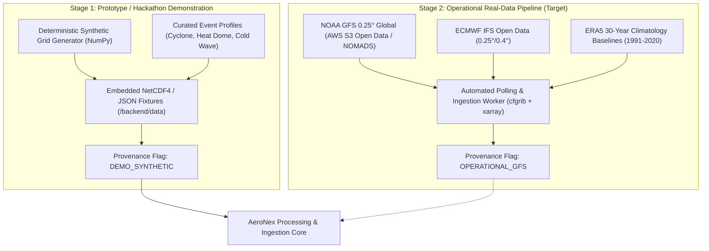
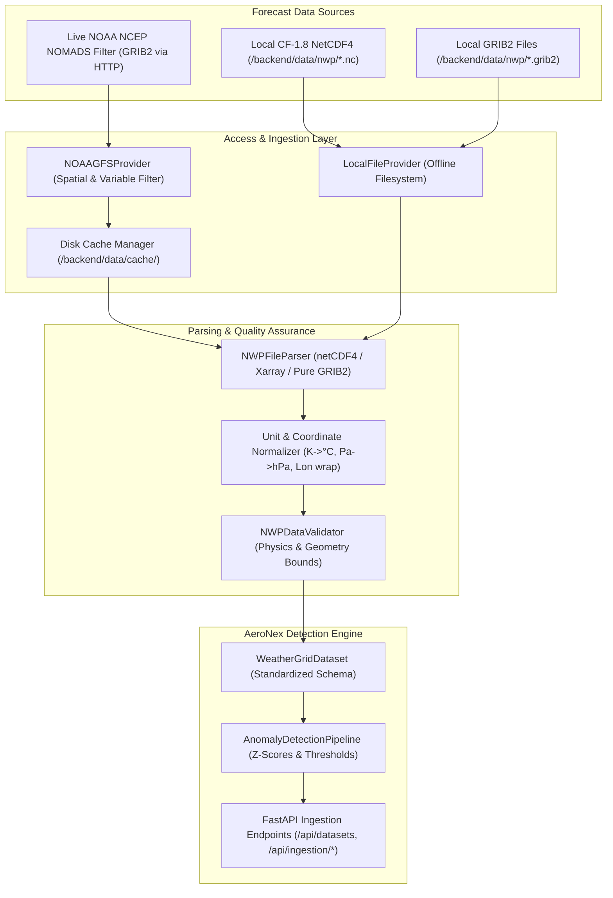

# AeroNex: Data Strategy & Ingestion Specification

[-orange.svg)]()

This document defines the complete data management lifecycle for **AeroNex**, encompassing the two-stage ingestion strategy (Synthetic Prototype vs. Real NWP Ingestion), comprehensive meteorological data dictionary, coordinate harmonization rules, and data quality standards.

---

## 1. Two-Stage Data Strategy

### 1.1 Stage 1: Prototype Strategy (Current Implementation Scope)
To ensure reliable, deterministic, zero-configuration evaluation during the Smart India Hackathon:
* **Self-Contained Data Bundles**: AeroNex generates and bundles curated, meteorologically realistic sample grids stored as NetCDF4 (`.nc`) and JSON fixtures in `backend/data/`.
* **Zero External Network Dependencies**: The application runs completely offline without requiring API keys, FTP credentials, or high-bandwidth downloads of 20GB operational files.
* **Realistic Weather Scenarios**: Four predefined meteorological scenarios are modeled across multiple forecast steps ($T+0h$ to $T+240h$):
  1. *Severe Tropical Cyclone (Bay of Bengal)*: Central MSLP dropping to $972\ hPa$, max sustained winds $> 38\ m/s$, advancing northwestward towards the Odisha/West Bengal coastline.
  2. *Severe Heat Dome & Heatwave (North/Central India)*: 2m temperatures exceeding $44^\circ C$ ($> 3.2\sigma$ above climatology), persisting across Rajasthan, Madhya Pradesh, and Uttar Pradesh.
  3. *Himalayan Cold Wave Outbreak (Northern Sector)*: Rapid freezing air plunge dropping 2m temperatures below $-12^\circ C$ ($< -2.8\sigma$).
  4. *Arabian Sea Monsoonal Wind Squall*: Sustained gale-force winds ($> 22\ m/s$) with anomalous pressure gradient.
* **Explicit Provenance Labeling**: All payloads, API responses, and UI banners contain `data_source: "DEMO_SYNTHETIC"` and `is_simulated: true` to adhere strictly to scientific transparency.

### 1.2 Stage 2: Real Data Integration (Operational Target)
Post-hackathon architecture transitions to live operational model ingestion:

| Source | Model / Product | Grid Resolution | Temporal Frequency | Access Protocol | Licensing & Terms |
| :--- | :--- | :--- | :--- | :--- | :--- |
| **NOAA NCEP** | GFS (Global Forecast System) | $0.25^\circ \times 0.25^\circ$ ($\sim 27\ km$) | 4x daily (00Z, 06Z, 12Z, 18Z), hourly to 120h, 3-hourly to 384h | AWS S3 Registry of Open Data (`s3://noaa-gfs-bdp-pds`) / NOMADS HTTP | Public Domain (US Gov open data policy). Free public download. |
| **ECMWF** | IFS Open Data (Open IFS) | $0.25^\circ \times 0.25^\circ$ (or $0.4^\circ$) | 4x daily (00Z, 06Z, 12Z, 18Z), 3-hourly to 240h | ECMWF Open Data API / AWS S3 Open Data | Creative Commons CC-BY 4.0. Attribution required. |
| **Copernicus / ECMWF** | ERA5 Reanalysis (Climatology) | $0.25^\circ \times 0.25^\circ$ | Monthly / Daily baselines (1991–2020 30-year normal) | Copernicus Climate Data Store (CDS API) | Copernicus Open Access License. |

---

## 2. Meteorological Data Dictionary

The following table standardizes all primary and derived meteorological parameters ingested and produced by AeroNex:

| Parameter Key | CF Standard Name | GRIB Code / Abbr | Storage Unit | Display Unit | Physical Bounds | Description |
| :--- | :--- | :--- | :--- | :--- | :--- | :--- |
| `t2m` | `air_temperature` | `2t` | Kelvin ($K$) | Celsius ($^\circ C$) | $[-90, 65]^\circ C$ | Air temperature at 2 meters above ground level. |
| `u10` | `eastward_wind` | `10u` | $m/s$ | $m/s$ or $km/h$ | $[-100, 100]\ m/s$ | U-component of wind velocity at 10 meters (positive eastward). |
| `v10` | `northward_wind` | `10v` | $m/s$ | $m/s$ or $km/h$ | $[-100, 100]\ m/s$ | V-component of wind velocity at 10 meters (positive northward). |
| `ws10` | `wind_speed` | Derived | $m/s$ | $m/s$ or $km/h$ | $[0, 120]\ m/s$ | Scalar horizontal wind speed: $\sqrt{u_{10}^2 + v_{10}^2}$. |
| `msl` / `mslp`| `air_pressure_at_mean_sea_level` | `prmsl` | Pascal ($Pa$) | Hectopascal ($hPa$) | $[870, 1085]\ hPa$ | Atmospheric pressure reduced to standard mean sea level. |
| `lat` | `latitude` | `latitude` | Degrees North | Decimal Degrees | $[-90.0, 90.0]^\circ$ | Geographic latitude (WGS84 EPSG:4326). |
| `lon` | `longitude` | `longitude` | Degrees East | Decimal Degrees | $[-180.0, 180.0]^\circ$ | Geographic longitude (WGS84 EPSG:4326). |
| `step` | `forecast_period` | `step` | Hours | Hours / Days | $[0, 240]\ h$ | Elapsed forecast lead time from model initialization. |
| `valid_time` | `time` | `valid_time` | ISO 8601 UTC | Formatted UTC | Timestamp | The exact UTC calendar time for which the forecast is valid. |
| `anomaly_score`| Derived | `zscore` | Dimensionless | Standard Deviations ($\sigma$) | $[-8.0, 8.0]\sigma$ | Standardized departure from reference climatological mean. |
| `footprint` | Derived | GeoJSON | Vector Geometry | Map Overlay | Closed Ring | Vector polygon bounding an anomalous contiguous cluster. |

---

## 3. Coordinate Handling & Spatial Transformations

### 3.1 Coordinate Reference System (CRS)
* **Standard Grid CRS**: WGS84 (`EPSG:4326`), represented as decimal degrees.
* **Web Mapping Projection**: Pseudo-Mercator (`EPSG:3857`), utilized by Leaflet client tiles. Transformations between EPSG:4326 vector coordinates and EPSG:3857 viewport coordinates are handled natively by Leaflet.

### 3.2 Longitude Wrapping & Normalization
Global NWP models frequently output longitudes in the range $[0.0, 360.0)^\circ E$ (e.g., GFS raw GRIB files).
* AeroNex automatically applies wrapping logic during ingestion to normalize longitudes to the standard international geographic convention $[-180.0, 180.0]^\circ$:
$$\lambda_{normalized} = (\lambda + 180 \pmod{360}) - 180$$
* For bounding box filters crossing the International Date Line ($180^\circ$ meridian), queries are evaluated as two disjoint spatial boxes or using multi-part geometry to prevent global polygon wrapping tears.

### 3.3 Polar Distortion & Cell Area Calculation
On a regular latitude-longitude grid ($\Delta\phi, \Delta\lambda$ in radians), the actual physical ground surface area of a grid cell decreases toward the poles according to the cosine of the latitude:
$$\text{Area}_{cell}(\phi) = R_E^2 \cdot \cos(\phi) \cdot \Delta\phi \cdot \Delta\lambda$$
Where:
* $R_E \approx 6,371.0088\ km$ (mean Earth radius).
* $\Delta\phi, \Delta\lambda$ are grid intervals in radians (e.g., $0.25^\circ \times \frac{\pi}{180} \approx 0.004363\ \text{rad}$).
* $\phi$ is the cell center latitude.

> [!NOTE]
> At the Equator ($\phi = 0^\circ$), a $0.25^\circ \times 0.25^\circ$ cell has an area of $\approx 773\ km^2$.
> At $\phi = 60^\circ N$, the same grid cell covers only $\approx 386\ km^2$ ($\cos(60^\circ) = 0.5$).
> AeroNex enforces cosine-latitude weighting when calculating aggregate anomaly footprint areas ($km^2$) to eliminate high-latitude overestimation.

---

## 4. Missing Values & Data Quality Guardrails

1. **Missing Value Conventions**:
   * NetCDF standard: CF-compliant `_FillValue = 9.96921e+36f` or `NaN`.
   * Backend Python: Mapped immediately to IEEE 754 `np.nan` floats.
   * Client JSON: Missing values are serialized as `null` or excluded from interpolation to avoid artificial zero values.
2. **Physical Plausibility Bounds Check**:
   During ingestion, any grid value outside physical reality (e.g., Surface pressure $< 850\ hPa$ or $> 1100\ hPa$, or Temperature $< 170\ K$ or $> 340\ K$) triggers a critical validation error. The corrupted cell is flagged as masked rather than propagating through anomaly filters.
3. **Temporal Monotonicity**:
   Forecast timesteps must increase monotonically ($T+0, T+6, T+12 \dots T+240$). Slices with non-sequential or duplicated timestamps are rejected during validation.

---

## 5. Phase 5: Real NWP Ingestion Pipeline Architecture

Phase 5 operationalizes real Numerical Weather Prediction data ingestion in AeroNex, bridging operational forecast products with the downstream anomaly detection engine while preserving deterministic offline fallback.

### 5.1 Verified Remote Provider: NOAA NCEP NOMADS GRIB Filter

AeroNex integrates directly with the official NOAA Operational Model Archive and Distribution System (NOMADS) GRIB Filter service:

* **Official Endpoint**: `https://nomads.ncep.noaa.gov/cgi-bin/filter_gfs_0p25.pl`
* **Directory Index**: `https://nomads.ncep.noaa.gov/pub/data/nccf/com/gfs/prod/`
* **Model Grid**: GFS $0.25^\circ \times 0.25^\circ$ global atmospheric model.
* **Initialization Cycles**: 4 times daily (`00Z`, `06Z`, `12Z`, `18Z`).
* **Lead Times**: Hourly out to $120\text{h}$, 3-hourly from $120\text{h}$ to $384\text{h}$.
* **Data Retention**: Rolling 10-day operational retention window on NOMADS.

#### Server-Side Subsetting Parameters (Verified Query Protocol):
Rather than downloading full 500 MB global operational files, AeroNex leverages NOMADS server-side byte-range extraction:

| Parameter Key | Purpose | Example Value |
| :--- | :--- | :--- |
| `dir` | Target cycle directory | `/gfs.20260926/00/atmos` |
| `file` | Target GRIB2 forecast step | `gfs.t00z.pgrb2.0p25.f024` |
| `subregion` | Enables server-side spatial windowing | `on` |
| `toplat` / `bottomlat` | Latitude bounds (degrees) | `38` / `8` (South Asia domain) |
| `leftlon` / `rightlon` | Longitude bounds (degrees) | `65` / `95` (South Asia domain) |
| `var_TMP` + `lev_2_m_above_ground` | 2-meter air temperature | `on` |
| `var_UGRD` + `var_VGRD` + `lev_10_m_above_ground` | 10-meter wind components | `on` |
| `var_PRMSL` + `lev_mean_sea_level` | Pressure reduced to mean sea level | `on` |
| `var_APCP` + `lev_surface` | Total precipitation accumulation | `on` |

> [!TIP]
> **Bandwidth Reduction**: Server-side filtering reduces payload size from **~500 MB** to **~15 KB – 50 KB**, enabling sub-second downloads, instant parsing, and minimal network overhead.

### 5.2 Local File Provider & Format Parsing

For offline hackathon demonstrations, sandboxed environments, and reproducible testing, AeroNex includes `LocalFileProvider`:

1. **CF-1.8 NetCDF4 Parser**:
   * Uses `netCDF4` and `xarray` to parse multidimensional arrays.
   * Standard sample dataset bundled in `backend/data/nwp/gfs_sample_0p25_south_asia.nc` (306 KB, 121×121 grid points covering $8^\circ\text{N}–38^\circ\text{N}$, $65^\circ\text{E}–95^\circ\text{E}$).
2. **Pure Python GRIB2 Message Parser**:
   * Inspects binary GRIB2 section headers (`GRIB`, Section 0/1/4/7) without requiring native C shared libraries (`libeccodes.dll`), providing zero-dependency operational compatibility across Windows, Linux, and macOS.

### 5.3 Data Validation Guardrails (`NWPDataValidator`)

Every incoming dataset undergoes rigorous meteorological quality assurance before being fed into downstream anomaly detectors:

| QA Rule | Check Specification | Error Threshold / Action |
| :--- | :--- | :--- |
| **Coordinate Regularity** | 1D coordinates monotonically increasing or decreasing | Reject irregular curvilinear grids |
| **Latitude Range** | All $\phi \in [-90.0, 90.0]^\circ$ | Reject out-of-bounds coordinates |
| **Longitude Wrapping** | Normalized into $[-180.0, 180.0]^\circ$ or $[0.0, 360.0]^\circ$ | Wrap coordinates automatically |
| **Thermal Sanity** | $T \in [180.0, 340.0]\text{ K}$ or $[-93.15, 66.85]^\circ\text{C}$ | Reject unphysical temperatures |
| **Barometric Sanity** | $MSLP \in [850.0, 1085.0]\text{ hPa}$ | Reject non-atmospheric pressures |
| **Wind Velocity Sanity** | $\|U_{10}\|, \|V_{10}\| \le 150.0\text{ m/s}$ | Reject unphysical supersonic winds |
| **Precipitation Non-negativity** | $TP \ge 0.0\text{ mm}$ | Reject negative precipitation |
| **Missing Fraction** | Masked / NaN values $< 25\%$ of grid cells | Reject corrupted or incomplete slices |

### 5.4 Variable Name & Unit Normalization Mapping

| Provider Key | Standard Key | Original Units | Target Internal Unit | Conversion Formula |
| :--- | :--- | :--- | :--- | :--- |
| `TMP`, `t2m`, `2t` | `t2m` | Kelvin ($K$) | Celsius ($^\circ C$) | $T_{^\circ C} = T_K - 273.15$ |
| `UGRD`, `10u`, `u10` | `u10` | $m/s$ | $m/s$ | Direct (Validated) |
| `VGRD`, `10v`, `v10` | `v10` | $m/s$ | $m/s$ | Direct (Validated) |
| Derived | `ws10` | $m/s$ | $m/s$ | $WS_{10} = \sqrt{u_{10}^2 + v_{10}^2}$ |
| `PRMSL`, `msl`, `mslp` | `mslp` | Pascal ($Pa$) | Hectopascal ($hPa$) | $MSLP_{hPa} = P_{Pa} / 100.0$ |
| `APCP`, `tp` | `tp` | $kg/m^2$ or $m$ | Millimeters ($mm$) | If $m$: $TP_{mm} = TP_m \times 1000.0$ |

