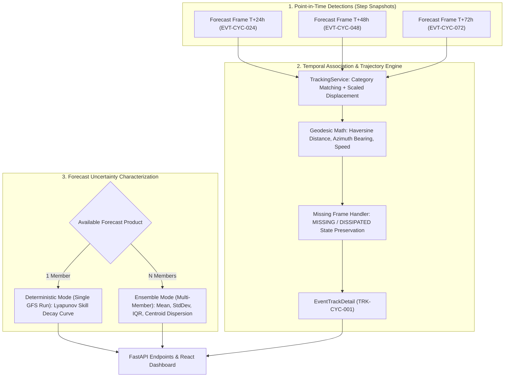

# AeroNex: Forecast Uncertainty, Event Tracking & Temporal Visualization Guide

This document establishes the scientific foundations, mathematical formulations, and engineering architecture for **Phase 6: Forecast Uncertainty, Event Tracking & Temporal Visualization** in **AeroNex**.

---

## 1. Architectural Overview & Conceptual Hierarchy

AeroNex maintains a clear distinction between individual point-in-time detection snapshots, continuous tracked series, and forecast uncertainty representations:

---

## 2. Event Association Methodology

### 2.1 Criteria for Sequential Linkage
When stitching discrete spatial anomaly detections across forecast lead times ($T+24h \to T+48h \to T+72h \dots$):

1. **Strict Category Invariance**:
   Anomalies of differing hazard classifications (e.g. Tropical Cyclone vs Heat Wave) are **never merged**, regardless of geographic proximity.
   $$\text{Category}(E_1) = \text{Category}(E_2)$$

2. **Geodesic Distance Proximity**:
   The Great-Circle distance between consecutive centroids must fall within a maximum displacement threshold scaled by elapsed forecast lead time:
   $$d_{haversine}(\text{Centroid}_1, \text{Centroid}_2) \le D_{max} \cdot \left(\frac{\Delta t}{24\text{ hours}}\right)$$
   Where $D_{max} = 850\text{ km}$ per 24 hours (accommodating rapid tropical cyclone translation speeds up to $\sim 35\text{ km/h}$).

3. **Spatial Intersection over Union (IoU)**:
   For expansive systems (e.g. Heat Domes and Cold Waves), spatial footprint overlap is evaluated:
   $$\text{IoU}(A_1, A_2) = \frac{\text{Area}(A_1 \cap A_2)}{\text{Area}(A_1 \cup A_2)}$$
   Significant overlap ($\text{IoU} \ge 0.15$) establishes linkage even when the centroid shifts due to footprint deformation.

4. **Non-Association of Unrelated Events**:
   Unrelated events (e.g., a cyclone in the Western Indian Ocean and a heat dome in Central Asia) remain strictly segregated into distinct track identifiers (`TRK-CYC-001` vs `TRK-HEAT-002`).

---

## 3. Geodesic Mathematical Formulations

### 3.1 Great-Circle Haversine Distance with Anti-Meridian Handling
For two points $(\phi_1, \lambda_1)$ and $(\phi_2, \lambda_2)$ in radians:
$$\Delta\phi = \phi_2 - \phi_1$$
$$\Delta\lambda = ((\lambda_2 - \lambda_1 + \pi) \pmod{2\pi}) - \pi$$
$$a = \sin^2\left(\frac{\Delta\phi}{2}\right) + \cos(\phi_1)\cos(\phi_2)\sin^2\left(\frac{\Delta\lambda}{2}\right)$$
$$d = 2 R_E \cdot \text{atan2}(\sqrt{a}, \sqrt{1 - a})$$
Where mean Earth radius $R_E = 6371.0088\text{ km}$.

### 3.2 Forward Azimuth (Bearing) & Cardinal Mapping
Initial forward bearing $\theta \in [0^\circ, 360^\circ)$ from point 1 to point 2:
$$y = \sin(\Delta\lambda)\cos(\phi_2)$$
$$x = \cos(\phi_1)\sin(\phi_2) - \sin(\phi_1)\cos(\phi_2)\cos(\Delta\lambda)$$
$$\theta = (\text{atan2}(y, x) \times \frac{180}{\pi} + 360) \pmod{360}$$
The bearing is mapped to a 16-point compass rose:
$$\text{Index} = \left\lfloor \frac{\theta + 11.25^\circ}{22.5^\circ} \right\rfloor \pmod{16} \implies \{\text{N, NNE, NE, ENE, E, ESE, SE, SSE, S, SSW, SW, WSW, W, WNW, NW, NNW}\}$$

### 3.3 Footprint Translation Speed
$$\text{Speed} = \frac{d_{haversine}(\text{Centroid}_{prev}, \text{Centroid}_{curr})}{\Delta t_{\text{hours}}}\text{ [km/h]}$$

### 3.4 Footprint Area Change
$$\Delta \text{Area} = \text{Area}_{curr} - \text{Area}_{prev}\text{ [km}^2\text{]}$$
$$\%\Delta \text{Area} = \left(\frac{\text{Area}_{curr} - \text{Area}_{prev}}{\text{Area}_{prev}}\right) \times 100\%$$

---

## 4. Missing Frames & Detection Continuity

AeroNex rigorously distinguishes between:
* **`DETECTED`**: The anomaly footprint meets or exceeds physical threshold criteria at the forecast timestep.
* **`MISSING`**: The event is unassociated or below threshold at an intermediate lead time. Fictitious coordinates are **never interpolated**.
* **`DISSIPATED`**: The system has decayed below critical thresholds for all subsequent forecast steps.

> [!IMPORTANT]
> **Scientific Integrity Caveat**:
> "Derived movement represents the displacement of detected forecast footprint centroids across successive forecast frames; it does not constitute an officially verified storm track."

---

## 5. Forecast Uncertainty Characterization

### 5.1 Deterministic Fallback Mode (Single GFS Run)
When evaluating deterministic operational forecasts (e.g. NOAA GFS 0.25° deterministic run, $N=1$):
* **No Fabricated Variance**: AeroNex explicitly forbids generating artificial ensemble spread or fabricated confidence percentages.
* **Lead-Time Skill Decay Profile**: Predictability limits governed by the atmospheric Lyapunov exponent ($\sigma(t) \propto \sigma_0 e^{\lambda t}$) are transparently reported:
  - **Days 1–3 ($0–72\text{h}$)**: **HIGH CONFIDENCE** ($82\%–95\%$). Synoptic flow skill is high; tight deterministic consensus.
  - **Days 4–6 ($72–144\text{h}$)**: **MODERATE CONFIDENCE** ($52\%–72\%$). Convective parameterization divergences begin; track spread widens.
  - **Days 7–10 ($144–240\text{h}$)**: **LOW / TREND-ONLY CONFIDENCE** ($22\%–42\%$). High chaotic sensitivity to initial conditions; advisory caution.

### 5.2 Multi-Member Ensemble Mode (e.g. Synthetic Ensemble Demo)
When $N \ge 3$ aligned ensemble members are available:
1. **Intra-Ensemble Mean & Standard Deviation**:
   $$\mu = \frac{1}{N}\sum_{i=1}^N x_i, \quad \sigma = \sqrt{\frac{1}{N-1}\sum_{i=1}^N (x_i - \mu)^2}$$
2. **Interquartile Range (IQR)**:
   $$\text{IQR} = Q_{75} - Q_{25}$$
3. **Centroid Spatial Dispersion ($km$)**:
   $$\bar{\phi} = \frac{1}{N}\sum \phi_i, \quad \bar{\lambda} = \frac{1}{N}\sum \lambda_i$$
   $$\text{Dispersion} = \frac{1}{N}\sum_{i=1}^N d_{haversine}\left(\bar{\phi}, \bar{\lambda}, \phi_i, \lambda_i\right)$$
4. **Member Agreement Percentage**:
   $$\text{Agreement} = \left(\frac{N_{\text{detected}}}{N_{\text{total}}}\right) \times 100\%$$
   Reflects the fraction of perturbed members confirming the extreme event within the search domain.

---

## 6. Synthetic Evaluation Scenarios Summary

| Scenario ID | Name & Category | Evaluated Behavior | Ground Truth Outcome |
| :--- | :--- | :--- | :--- |
| **Scenario 1** | `TRK-CYC-001` (Cyclone) | Northwestward translation, area growth ($320\text{k} \to 420\text{k}\text{ km}^2$), dissipation by Day 6 | Net displacement $1,042.5\text{ km}$, mean speed $10.9\text{ km/h}$, peak wind $150\text{ km/h}$ |
| **Scenario 2** | `TRK-HEAT-002` (Heat Dome) | Quasi-stationary expansion ($420\text{k} \to 610\text{k}\text{ km}^2$), thermal peak $44.8^\circ\text{C}$, dissipation Day 5 | Net displacement $377\text{ km}$, slow continental shift |
| **Scenario 3** | `TRK-COLD-003` (Cold Wave) | Intermittent detection with Day 3 missing frame | Day 3 marked `MISSING` without fake coords; Day 4 speed calculated across 48h gap |
| **Scenario 4** | Segregation Test | Concurrent Cyclone & Heat Wave in different regions | Preserved as 2 distinct tracks without cross-category merging |
| **Scenario 5** | `SYNTHETIC_ENSEMBLE_DEMO` | 5 reproducible perturbed members for Cyclone | Agreement decays from $100\%$ to $60\%$; dispersion expands from $14.2\text{ km}$ to $142.1\text{ km}$ |

---

## 7. REST Endpoints Specification

* `GET /api/events/tracks`: Summaries of all multi-horizon anomaly series.
* `GET /api/events/tracks/{track_id}`: Comprehensive track profile, net displacement, speed, and caveats.
* `GET /api/events/tracks/{track_id}/history`: Chronological array of `TrackPoint` objects (Days 1–10).
* `GET /api/uncertainty`: System-wide uncertainty mode and lead-time decay profile.
* `GET /api/uncertainty/{event_id}`: Event-specific uncertainty analysis (ensemble metrics or deterministic caveats).
