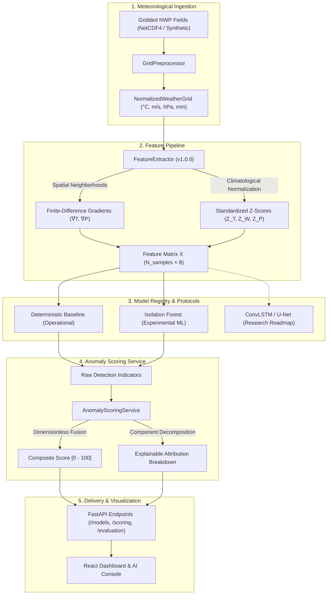

# AeroNex: Advanced AI/ML Architecture & Model Management Specification

This document provides the definitive architectural specification for the **AeroNex AI/ML intelligence layer**. It details feature representations, model protocols, the multi-component anomaly scoring engine, isolation tree algorithms, spatiotemporal research extensions, and artifact governance.

---

## 1. High-Level AI/ML System Architecture

---

## 2. Core Scientific Disambiguation

To preserve meteorological truth, AeroNex enforces strict boundaries between analytical paradigms:

| Concept | What It Is in AeroNex | What It Is NOT |
| :--- | :--- | :--- |
| **Statistical Anomaly Detection** | Measuring mathematical deviation ($Z$-scores, isolation depths) from reference normals at a valid timestep. | It does **not** predict future events or storm trajectories. |
| **Prognostic Weather Forecasting** | Generated upstream by numerical weather prediction (NWP) dynamical cores (e.g. NOAA GFS, ECMWF IFS). | AeroNex does **not** generate raw predictive weather from scratch. |
| **Anomaly Severity Index** | A continuous multi-criteria index on $[0.0, 100.0]$ synthesizing thermal, wind, pressure, and spatial departures. | It is **never** a calibrated statistical probability of catastrophe. |
| **Experimental ML Baseline** | An unsupervised Isolation Forest testing high-dimensional feature representations on synthetic perturbation grids. | It is **not** an operational forecasting model and has no proof of real-world skill without observational reanalysis. |

---

## 3. Versioned Feature Schema (`v1.0.0`)

The model pipeline uses an explicit, immutable feature schema defined in `app.ml.features.FEATURE_COLUMNS`. Features are extracted consistently across training and inference.

### 3.1 Feature Columns & Physical Rationale

| Column Index | Feature Key | Physical Meaning | Preprocessing & Normalization |
| :---: | :--- | :--- | :--- |
| `0` | `temp_anomaly_z` | Standardized 2m air temperature departure | $Z_T = (T - \mu_{clim}) / \sigma_{clim}$, clipped to $[-8.0, 8.0]$ |
| `1` | `wind_anomaly_z` | Standardized 10m wind speed departure | $Z_W = (W - \mu_{clim}) / \sigma_{clim}$, clipped to $[-4.0, 10.0]$ |
| `2` | `mslp_anomaly_z` | Standardized central pressure departure | $Z_P = (P - \mu_{clim}) / \sigma_{clim}$, clipped to $[-10.0, 6.0]$ |
| `3` | `precip_rate_normalized` | 24h accumulated rainfall rate | Logarithmic compression: $\log(1 + P) / \log(1 + 250.0) \in [0, 1]$ |
| `4` | `local_temp_grad` | Local thermal gradient magnitude | Finite-difference $|\nabla T| = \sqrt{(\partial T/\partial y)^2 + (\partial T/\partial x)^2}$ |
| `5` | `local_mslp_grad` | Local barometric gradient magnitude | Finite-difference $|\nabla P| = \sqrt{(\partial P/\partial y)^2 + (\partial P/\partial x)^2}$ |
| `6` | `normalized_lead_time` | Forecast horizon lead time | Linear temporal scaling: $\text{lead\_hours} / 240.0 \in [0.0, 1.0]$ |
| `7` | `data_quality_factor` | Local spatial grid completeness | Ratio of valid non-NaN cells in $3 \times 3$ window $[0.0, 1.0]$ |

### 3.2 Geographic Non-Memorization Safeguard
Absolute latitude and longitude coordinates ($\phi, \lambda$) are **strictly excluded** from the feature representation. This prevents the unsupervised ML model from memorizing specific geographic locations (e.g. associating the Bay of Bengal exclusively with low pressure) rather than learning invariant physical relationships.

---

## 4. Multi-Component Normalized Anomaly Scoring Framework

AeroNex provides a dedicated scoring engine (`app.ml.scoring.AnomalyScoringService`). Incomparable raw physical units ($^\circ\text{C}$, $\text{km/h}$, $\text{hPa}$, $\text{km}^2$) are **never** combined directly.

### 4.1 Scoring Mathematical Formulation
The composite departure score is computed as:
$$\text{CompositeScore} = \sum_{k=1}^6 w_k \cdot S_k, \quad S_k \in [0.0, 1.0], \quad \sum_{k=1}^6 w_k = 1.0$$

Where the default weightings are:
* $w_{temp} = 0.25$ (Thermal deviation)
* $w_{wind} = 0.20$ (Wind velocity magnitude)
* $w_{press} = 0.20$ (Barometric pressure deficit)
* $w_{spat} = 0.15$ (Spatial footprint area)
* $w_{pers} = 0.10$ (Multi-horizon temporal persistence)
* $w_{qual} = 0.10$ (Observational data quality)

### 4.2 Normalization Transfer Functions
* **Temperature Anomaly ($S_{temp}$)**:
  $$S_{temp} = 1.0 - \exp\left(-\frac{|T - \mu_{clim}|}{2.5 \cdot \sigma_{clim}}\right)$$
* **Wind Speed Anomaly ($S_{wind}$)**:
  $$S_{wind} = 0.1 + 0.9 \cdot \left[1.0 - \exp\left(-\frac{\max(0, W - 35.0)}{60.0}\right)\right]$$
* **Pressure Deficit ($S_{press}$)**:
  $$S_{press} = 1.0 - \exp\left(-\frac{\max(0, 1013.25 - P_{central})}{30.0}\right)$$
* **Spatial Extent ($S_{spat}$)**:
  $$S_{spat} = \frac{\log_{10}(\text{Area}) - \log_{10}(5000)}{\log_{10}(750000) - \log_{10}(5000)} \quad \text{clamped to } [0.0, 1.0]$$
* **Temporal Persistence ($S_{pers}$)**:
  $$S_{pers} = \min\left(1.0, \frac{N_{active\_days}}{5.0}\right)$$
* **Data Quality Penalty ($S_{qual}$)**:
  $$S_{qual} = \max(0.2, 1.0 - 1.5 \cdot \text{MissingFraction})$$

### 4.3 Severity Classification Heuristic
Categorical tiers are decoupled from the continuous score $[0.0, 100.0]$:
* **Extreme**: Score $\ge 75.0$
* **High**: $50.0 \le \text{Score} < 75.0$
* **Medium**: $25.0 \le \text{Score} < 50.0$
* **Low**: $\text{Score} < 25.0$

---

## 5. Model Interface & Registered Implementations

### 5.1 `AnomalyModel` Abstract Interface Protocol
Every model implements `app.ml.interfaces.AnomalyModel`:
* `fit(X, y=None)`: Parameter fitting / baseline initialization.
* `predict(X)`: Binary anomaly indicator ($1$ for anomaly, $0$ for normal).
* `score_samples(X)`: Continuous deviation score on $[0.0, 1.0]$.
* `save(filepath)`: Secure serialization.
* `load(filepath)`: Validated artifact deserialization.
* `metadata()`: Structured `ModelMetadata` envelope.

### 5.2 Registered Implementations

#### 1. `DeterministicBaselineModel`
* **Status**: `OPERATIONAL_BASELINE`
* **Methodology**: Physical heuristics combining 3-sigma climatological departures ($Z \ge 3.0$), barometric deficits ($MSLP \le 992\text{ hPa}$), and extreme precipitation rates.
* **Storage**: JSON parameter configuration (`deterministic_baseline.json`).

#### 2. `IsolationForestAnomalyModel`
* **Status**: `EXPERIMENTAL_SYNTHETIC_BENCHMARK`
* **Methodology**: Unsupervised ensemble of 100 isolation trees with $6\%$ contamination factor. Computes path length in 8D feature space; decision function is mapped via sigmoid scaling:
  $$\text{Score} = \frac{1}{1 + \exp(8 \cdot \text{decision\_function}(X))}$$
* **Storage**: Binary weights via `joblib` paired with sidecar metadata JSON (`isolation_forest_v1.joblib.meta.json`). Validates feature schema version upon deserialization.

#### 3. `SpatiotemporalResearchModelStub`
* **Status**: `RESEARCH_ROADMAP`
* **Architecture Target**: Recurrent-Convolutional U-Net (ConvLSTM / 3D-UNet).
* **Input Tensor Contract**: `(batch_size, timesteps=10, channels=4, height=96, width=161)`.
* **Output Tensor Contract**: `(batch_size, timesteps=10, num_classes=5, height=96, width=161)`.
* **Safety Invariant**: Calling `predict()` raises `NotImplementedError` with explicit instructions regarding required historical reanalysis training.

---

## 6. Model Registry & Governance

The singleton `ModelRegistry` (`app.ml.registry.model_registry`) enforces:
1. **Default Production Safety**: Automatically defaults to `deterministic_baseline`.
2. **Restricted Storage**: Model artifacts are restricted to `backend/data/models/`; arbitrary filesystem paths are blocked.
3. **Sidecar Validation**: Pickled joblib files are checked against sidecar `.meta.json` feature schemas prior to deserialization to prevent schema drift.
4. **Research Stub Protection**: Model selection API rejects activation of `RESEARCH_ROADMAP` stubs with HTTP 400.
