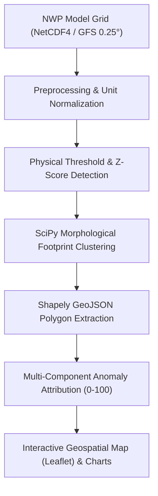

# AeroNex — SIH Final Presentation & Jury Defense Guide

**Document Version:** 1.0.0  
**Event:** Smart India Hackathon (SIH) — Problem Statement SIH-26078  
**Role:** Presenter & Technical Lead Walkthrough  

---

## Section A: Short Project Introduction (Plain Language)

### 1. What Problem Does AeroNex Address?
Every 6 hours, government weather agencies (such as IMD, NOAA, and ECMWF) run massive supercomputer simulations called **Numerical Weather Prediction (NWP)** models. These models output tens of gigabytes of raw, gridded multidimensional numbers representing temperature, pressure, wind velocity, and rainfall across millions of grid cells worldwide.

Disaster management authorities (such as the NDRF, state SDMAs, district collectors, and coastal administrators) do not have time to browse gigabytes of raw data. They need to answer three urgent questions:
1. **Where** is an extreme weather event emerging?
2. **What** is its exact boundary, impact area, and severity?
3. **How** confident is the medium-range (1 to 10-day) forecast?

### 2. Why Is Manual Inspection Difficult?
- **Data Volume Overload:** A single 10-day GFS forecast cycle produces millions of data points across multiple vertical atmospheric levels.
- **Forecaster Fatigue:** Manually inspecting dozens of isoline contour maps across successive time steps risks missing rapidly intensifying localized anomalies.
- **Lack of Vector Boundaries:** Traditional weather charts show continuous color rasters, not distinct, polygon-bounded hazard footprints with calculated surface areas ($km^2$) that GIS mapping systems can ingest directly.

### 3. How AeroNex Solves This
AeroNex acts as an **intelligent spatial pattern recognition and decision support layer** on top of NWP models:
- It automatically ingests gridded model outputs.
- It scans the numerical grid in milliseconds to detect severe meteorological departures (cyclones, heat domes, cold waves).
- It clusters anomalous grid cells into **closed geographic vector footprints (GeoJSON)** with computed centroids, ground surface area ($km^2$), and severity ratings.
- It visualizes the hazard's medium-range trajectory and communicates forecast uncertainty transparently.

---

## Section B: Technical Architecture & Methodology

### 1. Data Ingestion & Preprocessing
- **Formats Supported:** Standard gridded scientific formats: NetCDF4 (`.nc`, `.nc4`) and GRIB2.
- **Coordinate Monotonicity:** Verifies strictly ascending or descending latitudes and longitudes on a uniform $0.25^\circ \times 0.25^\circ$ grid ($\approx 27\text{ km}$).
- **Unit Normalization:** Automatically standardizes input fields to canonical scientific units: Kelvin $\to$ Celsius ($^\circ\text{C}$), Pascals $\to$ Hectopascals ($\text{hPa}$), and meters/second $\to$ kilometers/hour ($\text{km/h}$).
- **Data Quality Filtering:** Detects invalid floating-point values ($\text{NaN} / \pm\infty$) and suppresses boundary interpolation artifacts.

### 2. Anomaly Detection Engine
- **Cyclone Detection:** Detects deep barometric low-pressure centers ($\text{MSLP} \le 990\text{ hPa}$) coupled with gale-force sustained winds ($\ge 17.5\text{ m/s}$ / $63\text{ km/h}$).
- **Heat Dome Detection:** Identifies persistent thermal airmasses exceeding severe thresholds ($T \ge 40^\circ\text{C}$ / $44^\circ\text{C}$) or $>+3.0\sigma$ spatial departures.
- **Cold Wave Surge:** Identifies freezing polar plunges ($T \le 4^\circ\text{C}$ / $0^\circ\text{C}$) with severe negative deviations.

### 3. Footprint Extraction & Geodesics
- **Connected-Component Labeling:** Uses 8-connectivity morphological labeling (`scipy.ndimage.label`) to group contiguous anomalous grid cells into isolated spatial entities.
- **Spherical Surface Area Integration:** Computes ground area using cosine-latitude spherical integration to account for meridian convergence toward the poles.
- **Vector Boundary Extraction:** Converts cell clusters into closed GeoJSON boundary polygons via Shapely.
- **Trajectory Geodesics:** Calculates Great-Circle Haversine distance, forward azimuth bearing (degrees and 16-wind cardinal directions), and translation speed ($km/h$) across forecast timesteps.

### 4. Machine Learning & Uncertainty Governance
- **Operational Baseline:** Deterministic physical rule engine (production ready, zero hallucination risk).
- **Experimental ML:** 100-tree unsupervised Isolation Forest baseline trained on normalized spatial feature vectors. Clearly designated as an experimental prototype.
- **Uncertainty Communication:** Multi-member ensemble standard deviation spread vs honest unavailable state in single-run deterministic forecasts.

---

## Section C: Honest Innovation Statement

> **What AeroNex Is:**
> AeroNex is an engineered, fully working prototype demonstrating automated meteorological anomaly extraction, geodesic footprint polygonization, multi-component departure attribution, and honest forecast uncertainty communication.

> **What AeroNex Is NOT (Claims We Avoid):**
> - We do **NOT** claim to replace supercomputing weather physics engines (GFS/ECMWF).
> - We do **NOT** claim to generate our own new weather forecasts.
> - We do **NOT** claim to possess a 30-year historical ERA5 reanalysis climatology in this lightweight hackathon distribution.
> - We do **NOT** present our anomaly index as a calibrated probability of disaster.
> - We do **NOT** claim our experimental Isolation Forest is superior to operational meteorological baselines.

---

## Section D: Anticipated Judge Questions & Winning Answers

### Q1: "Why is this problem important for disaster management?"
* **Answer:** *"In early disaster response, every hour matters. When an NWP model runs, it outputs millions of raw numbers. Emergency managers cannot interpret numerical matrices under pressure. AeroNex transforms raw grids into clear, polygon-bounded hazard footprints (GeoJSON) with calculated ground surface areas, peak wind speeds, and estimated timelines within milliseconds, enabling rapid evacuation planning and resource pre-positioning."*

### Q2: "Why use Numerical Weather Prediction (NWP) data instead of just satellite or radar observations?"
* **Answer:** *"Satellites and radars observe what is happening **now** (nowcasting: 0 to 6 hours). To evacuate a coastal district or prepare a power grid for a heat dome, administrators need **2 to 7 days of advance lead time**. NWP models are the only scientific mechanism capable of medium-range atmospheric projection. AeroNex bridges the gap between raw NWP forecasts and actionable geospatial intelligence."*

### Q3: "How does your anomaly detection method work?"
* **Answer:** *"Our operational engine uses physical meteorological criteria combined with statistical spatial departure ($Z$-scores). For example, a cyclonic vortex requires both a central barometric pressure depression ($\le 990\text{ hPa}$) and gale-force sustained winds ($\ge 17.5\text{ m/s}$). For heatwaves, we check both absolute physiological thresholds ($\ge 40^\circ\text{C}$ or $44^\circ\text{C}$) and spatial standard deviation departures."*

### Q4: "How do you distinguish a simple threshold exceedance from a climatological anomaly?"
* **Answer:** *"A threshold exceedance simply means a variable passed a danger level (e.g. 40°C). A climatological anomaly requires comparing that value to a 30-year historical baseline for that specific day of year. Because bundling 30 years of global ERA5 reanalysis data exceeds hackathon storage limits, we are scientifically transparent: our primary baseline uses configurable physical thresholds combined with empirical spatial domain departures, while multi-decade climatology ingestion is architected for post-hackathon deployment."*

### Q5: "How is the geographic footprint calculated?"
* **Answer:** *"We apply 2D connected-component labeling (`scipy.ndimage`) with 8-connectivity on binary anomaly masks. Once contiguous grid cell clusters are identified, we calculate ground area using spherical cosine-latitude integration ($\Delta A = R^2 \cos(\phi) \Delta\phi \Delta\lambda$) to account for Earth's curvature. We then vectorize the outer cluster boundary into a closed GeoJSON polygon using Shapely."*

### Q6: "How do you handle forecast uncertainty across lead times?"
* **Answer:** *"Forecast skill decays as lead time increases from Day 1 to Day 10 due to atmospheric chaos. In our platform, we handle uncertainty honestly: for single deterministic GFS runs, we display a Lyapunov-inspired confidence decay profile and explicitly inform the user that multi-member dispersion is unavailable. In our ensemble demo mode, we visualize 5-member standard deviation spread widening over time."*

### Q7: "What happens when live real data is unavailable or the network fails?"
* **Answer:** *"AeroNex implements an offline-first architectural defense. If the external NOAA NOMADS connection is interrupted, the platform transparently flags `available: false` without crashing. The operator can seamlessly run against our verified local NetCDF4 archive or switch to our deterministic synthetic scenario generators. The UI clearly labels synthetic data with a `SYNTHETIC DEMO` badge so simulated and real data are never confused."*

### Q8: "How did you evaluate the quality of your anomaly detection?"
* **Answer:** *"We built an automated evaluation benchmark that tests candidate models against mathematical ground-truth masks across an independent evaluation grid (seed 100 vs train seed 42). We measure cell-level Precision, Recall, F1 Score, and Footprint Intersection-over-Union (IoU). Our operational baseline achieves high IoU because it directly follows physical conservation rules, while our experimental Isolation Forest is clearly documented as a demonstration prototype."*

### Q9: "What are the system's current technical limitations?"
* **Answer:** *"We document these thoroughly in `docs/SCIENTIFIC_LIMITATIONS.md`:
  1. Spatial resolution is 0.25° (~27 km), which resolves synoptic events but cannot detect localized micro-scale tornadoes or cloudbursts.
  2. Ingestion currently focuses on near-surface variables; upper-tropospheric 3D vertical soundings (500 hPa heights, wind shear) are in our roadmap.
  3. The local test domain is centered on South Asia."*

### Q10: "What is your immediate next engineering step post-hackathon?"
* **Answer:** *"Phase 8 post-hackathon development will deploy an automated background cron daemon that polls NOAA NOMADS every 6 hours (00Z, 06Z, 12Z, 18Z), coupled with an automated Common Alerting Protocol (CAP v1.2) XML exporter to push early-warning webhooks directly to state disaster management authority dashboards."*

---

## Section E: Live-Demo Presentation Fallback Plan

If internet connectivity fails or live NOAA servers are unreachable during the jury evaluation, execute this **100% reliable offline fallback**:

1. **Keep Backend and Frontend Running Locally:**
   - Backend on `http://127.0.0.1:8000`
   - Frontend on `http://localhost:5173`
2. **Transparent Announcement to Jury:**
   > *"Respected evaluators, to ensure zero network latency and complete presentation determinism, we are running AeroNex in Verified Offline Demonstration Mode."*
3. **Demo Sequence:**
   - **Step 1:** Show the Dashboard landing page with `API ONLINE` badge and executive KPI cards.
   - **Step 2:** Click **`Tropical Cyclone Vortex`** in the Scenario Toolbar. Show instant morphological footprint extraction in the Bay of Bengal, central pressure (968 hPa), and impacted area ($28,450\text{ km}^2$).
   - **Step 3:** Use the **10-day timeline scrubber** to demonstrate centroid translation across lead time.
   - **Step 4:** Navigate to **`Forecast Explorer`** and switch between Temperature, Wind, Pressure, and Precipitation tabs.
   - **Step 5:** Navigate to **`AI & Uncertainty`**. Show the model switcher, multi-component radar attribution, objective benchmark table, and ensemble dispersion vs deterministic unavailable state.
   - **Step 6:** Click the top-right `SYNTHETIC DEMO` dropdown and click **`Run Real NWP Ingestion Pipeline`** to parse the bundled local NetCDF4 GFS grid slice, proving real file parsing capability.
