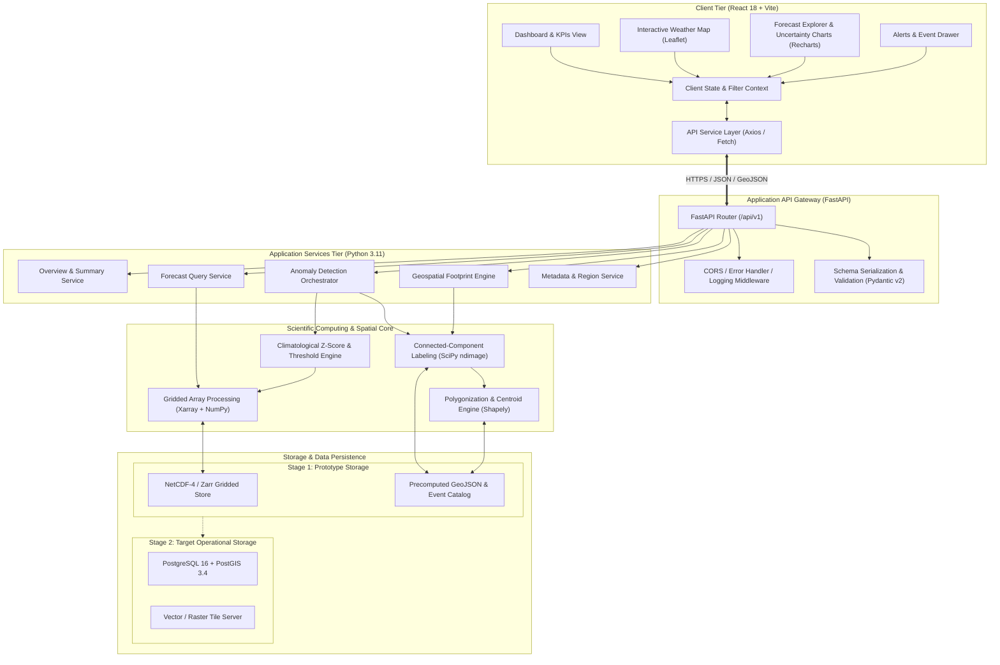
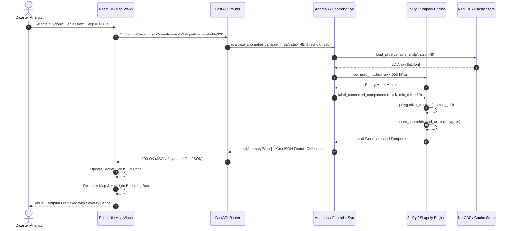
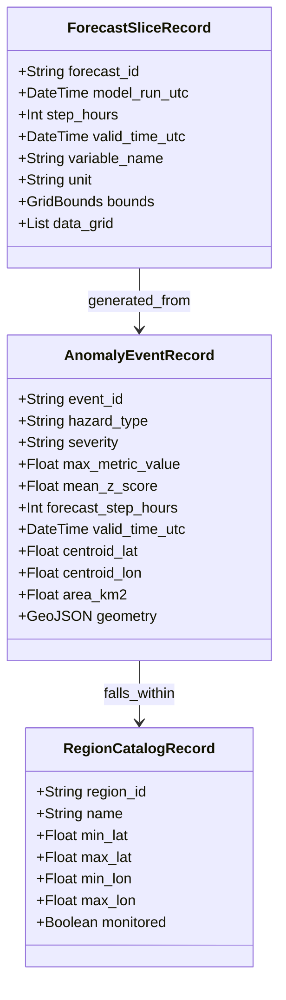
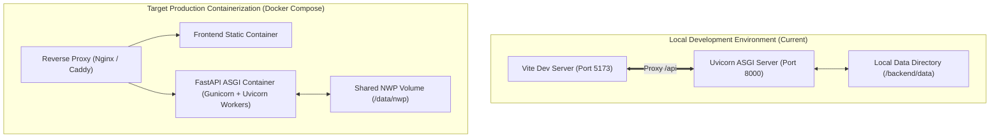

# AeroNex: System Architecture & Engineering Blueprint

This document provides a comprehensive architectural breakdown of the **AeroNex** platform, detailing its component hierarchy, communication contracts, geospatial processing pipelines, data storage models, and deployment topology.

---

## 1. Architectural Overview & Component Hierarchy

AeroNex is structured as a decoupled, service-oriented system designed to separate computationally intensive multidimensional scientific operations from interactive geospatial client rendering.

---

## 2. Component Responsibilities

### 2.1 Client Tier (React 18 + Vite)
* **Application Shell & Navigation**: Hosts the persistent sidebar, top status bar, and dynamic route routing via `React Router v6`.
* **Geospatial Map Rendering**: Powered by Leaflet/React-Leaflet, managing multiple map panes:
  * Base CartoDB Dark Matter / OpenStreetMap tiles.
  * Gridded raster or semi-transparent scalar contour layers.
  * Vector GeoJSON polygons representing anomaly footprints with dynamic styling based on hazard type and severity.
* **Forecast & Uncertainty Visualizer**: Interactive time-series visualizer powered by Recharts, plotting variable forecasts across 1-10 day horizons, with shaded confidence envelopes and baseline comparisons.
* **Client State & Cache**: Coordinates active timestep ($T+0h \dots T+240h$), selected region, active variables, and detection sensitivity thresholds across all views.

### 2.2 API Gateway & Router (FastAPI)
* **Request Validation**: Enforces strict typing on query parameters (e.g., bounding boxes, forecast lead times, variable names) via Pydantic v2 schemas.
* **Response Serialization**: Serializes analytical payloads into clean JSON and valid GeoJSON FeatureCollections (`RFC 7946`).
* **Error Handling**: Intercepts unhandled exceptions and validation errors, transforming them into RFC 7807 problem details.
* **CORS & Compression**: Manages cross-origin resource access for local frontend development and applies Gzip compression to large coordinate arrays.

### 2.3 Application Services Tier
* **Overview & Summary Service (`overview_service.py`)**: Computes real-time situational summaries: active anomaly count, severe alerts, monitored boundaries, and dataset metadata.
* **Forecast Service (`forecast_service.py`)**: Queries multidimensional slices for specific coordinates or bounding boxes across forecast lead times.
* **Anomaly Detection Service (`anomaly_service.py`)**: Coordinates the execution of threshold filtering and statistical z-score evaluation on ingested variable arrays.
* **Geospatial Footprint Service (`footprint_service.py`)**: Transforms 2D boolean anomaly matrices into continuous spatial polygons, calculates centroids, bounding boxes, and surface areas ($km^2$).
* **Metadata & Region Service (`metadata_service.py`)**: Supplies boundary definitions for administrative regions (e.g., Bay of Bengal, Arabian Sea, Northern Plains) and variable descriptions.

### 2.4 Scientific Processing Engine
* **Xarray & NumPy Core**: Slices, interpolates, and resamples 3D/4D arrays `(time, step, lat, lon)` with memory-efficient chunking.
* **SciPy ndimage**: Applies binary morphology and connected-component labeling (`scipy.ndimage.label`) to identify contiguous clusters of anomalous cells.
* **Shapely**: Handles geometric operations: polygon union, coordinate transformation, convex/concave hull wrapping, centroid computation, and area calculation using spherical approximations.

---

## 3. End-to-End Data Flow Sequence

The following sequence details how a user interaction triggers data retrieval, spatial processing, and vector rendering:

---

## 4. Detailed Data Processing Stages

```mermaid
graph LR
    subgraph S1 ["1. Ingestion"]
        A1["Raw GRIB2 / NetCDF / Synthetic"] --> A2["Coordinate Harmonization (0-360 to -180..180)"]
    end

    subgraph S2 ["2. Standardization"]
        A2 --> B1["Unit Conversion (K to °C, Pa to hPa)"]
        B1 --> B2["Missing Value Interpolation / Masking"]
    end

    subgraph S3 ["3. Anomaly Analysis"]
        B2 --> C1["Z-Score against Climatology"]
        B2 --> C2["Physical Threshold Filter"]
        C1 & C2 --> C3["Composite Anomaly Binary Mask"]
    end

    subgraph S4 ["4. Spatial Vectorization"]
        C3 --> D1["Connected Component Labeling"]
        D1 --> D2["Noise Filtering (< Min Area)"]
        D2 --> D3["Vector Polygonization (GeoJSON)"]
    end

    subgraph S5 ["5. Delivery"]
        D3 --> E1["REST API Payload"]
        E1 --> E2["Client Leaflet Map Rendering"]
    end
```

### Stage 1: Ingestion & Spatial Alignment
* Standardizes coordinate axes to increasing latitude $[-90, 90]$ and standard longitude $[-180, 180]$.
* Aligns multi-variable grids to a common spatial reference resolution (e.g., $0.25^\circ \times 0.25^\circ$).

### Stage 2: Physical Standardization
* Normalizes thermodynamic units: Kelvin ($K$) converted to Celsius ($^\circ C$).
* Normalizes barometric units: Pascals ($Pa$) converted to hectopascals ($hPa$).
* Derives scalar wind speed from orthogonal components: $WS = \sqrt{u_{10}^2 + v_{10}^2}$.

### Stage 3: Anomaly Mask Generation
* Computes dual-criteria masks:
  1. *Statistical Criterion*: Standard deviation departure: $Z_{lat,lon} \ge Z_{crit}$.
  2. *Physical Criterion*: Hard meteorological limit: e.g., $MSLP \le 992\ hPa$.
* Merges masks using logical operations (`AND` or `OR` depending on hazard profile).

### Stage 4: Spatial Clustering & Vectorization
* Evaluates 8-neighbor connectivity to identify cohesive regional weather systems.
* Discards isolated noise cells with surface area $< 2,500\ km^2$.
* Computes bounding box $[minLon, minLat, maxLon, maxLat]$ and geometric centroid $(\bar{\lambda}, \bar{\phi})$.
* Encodes the spatial boundary into GeoJSON `Polygon` or `MultiPolygon` format.

---

## 5. Storage Architecture & Evolution

### Stage 1: Prototype Implementation (Current Hackathon Scope)
* **File-Based Gridded Storage**: Structured NetCDF-4 (`.nc`) files or high-speed compressed JSON files stored in `backend/data/`.
* **In-Memory Cache**: Python in-memory dictionaries and LRU caching (`functools.lru_cache`) for pre-computed anomaly catalogs and GeoJSON footprints.
* **Benefits**: Zero database installation friction; instantaneous spin-up; 100% reproducible for evaluators without cloud infrastructure.

### Stage 2: Operational Target Architecture (Post-Hackathon Expansion)
* **Database Engine**: PostgreSQL 16 with the PostGIS 3.4 spatial extension.
* **Spatial Indexing**: GiST indices on geography columns for sub-millisecond bounding box queries and polygon clipping.
* **Tiling Engine**: Dynamic vector tile server (e.g., Martin or Tegola) delivering Mapbox Vector Tiles (`MVT`) for multi-million cell datasets.
* **Object Store**: AWS S3 or MinIO for raw GRIB2/Zarr meteorological archive.

---

## 6. Error Handling & System Resilience

1. **Input Range Guardrails**: If an incoming query specifies coordinates outside valid ranges (e.g., $Lat = 110^\circ$) or a forecast step exceeding model horizons, FastAPI raises a structured `422 Unprocessable Entity` with exact parameter paths.
2. **Missing Variable Fallback**: If an optional variable (e.g., vertical wind shear) is unavailable in the active dataset, the anomaly engine flags the result as `PARTIAL_EVALUATION` rather than aborting.
3. **Spatial Singularities**: Longitudinal transitions at $180^\circ$ and polar coordinate compression are handled gracefully by wrapping longitudes to the $[-180, 180]$ domain before spatial grouping.
4. **Client-Side Graceful Degradation**: If the backend API encounters an unhandled exception ($500$), the React UI renders an inline fallback card with a "Retry Analysis" button, keeping the rest of the dashboard functional.

---

## 7. Deployment Concept

* **Local Development**: Fast iteration with Vite HMR on `localhost:5173` proxying API requests to FastAPI/Uvicorn on `localhost:8000`.
* **Production Packaging**: Single-command execution via `docker-compose.yml` hosting multi-stage frontend builds served by Nginx alongside a containerized Python scientific runtime.
