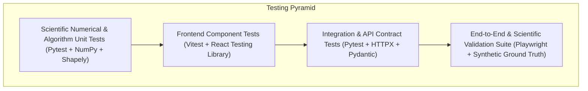
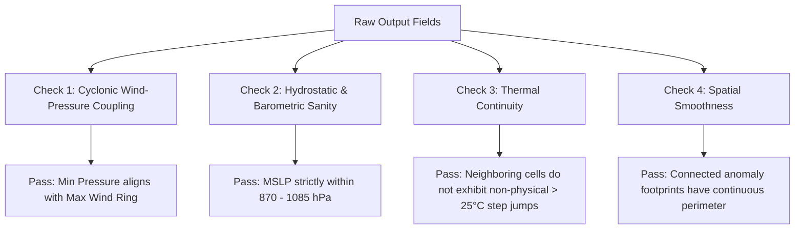

# AeroNex: Testing Strategy & Scientific Validation Plan

This document defines the quality assurance architecture, scientific validation methodologies, automated test suites, edge-case coverage, and measurable evaluation metrics for **AeroNex**.

> [!IMPORTANT]
> **No Fabricated Results Policy**: All performance metrics, accuracy scores, and processing times in this document represent **proposed target benchmarks and validation criteria**, not measured empirical results. Empirical benchmarks will be recorded only after automated test suite execution in Phase 8.

---

## 1. Testing Pyramid & Test Architecture

AeroNex implements a multi-tiered testing strategy spanning scientific numerical unit tests, API integration tests, and frontend UI component tests:

---

## 2. Test Suites Specification

### 2.1 Scientific Numerical & Preprocessing Unit Tests (`backend/tests/unit/`)

| Test File | Test Case Description | Target Invariant / Expected Behavior |
| :--- | :--- | :--- |
| `test_units.py` | Thermodynamic conversion ($K \rightarrow ^\circ C$) | $273.15\ K \equiv 0.0^\circ C$; $313.15\ K \equiv 40.0^\circ C$. Reversible within $10^{-6}$. |
| `test_units.py` | Barometric conversion ($Pa \rightarrow hPa$) | $101325\ Pa \equiv 1013.25\ hPa$. |
| `test_units.py` | Wind vector to scalar speed | $u=3.0, v=4.0 \rightarrow WS = 5.0\ m/s$. Negative components yield positive magnitude. |
| `test_coordinates.py`| Longitude wrapping ($[0, 360) \rightarrow [-180, 180]$) | $350^\circ E \rightarrow -10^\circ$; $180^\circ \rightarrow 180^\circ$; $-185^\circ \rightarrow 175^\circ$. |
| `test_coordinates.py`| Latitude bounds enforcement | Input $> 90^\circ$ or $< -90^\circ$ raises `ValueError`. |
| `test_anomaly_math.py`| $Z$-score calculation against zero variance | If $\sigma_{clim} = 0$, return $Z = 0.0$ and log warning rather than raising `ZeroDivisionError`. |
| `test_anomaly_math.py`| Extreme deviation calculation | $X = 45^\circ C, \mu = 30^\circ C, \sigma = 5^\circ C \rightarrow Z = +3.0\sigma$. |
| `test_morphology.py`| 8-Connectivity clustering | Adjacent diagonal pixels form a single entity; separate disconnected pixels form distinct labels. |
| `test_morphology.py`| Minimum area noise rejection | Clusters smaller than $\text{Area}_{min}$ are purged from the feature list. |
| `test_footprint.py` | Cosine-latitude area correction | A $1^\circ \times 1^\circ$ box at $60^\circ N$ calculates to approximately half the area of the same box at $0^\circ$ equator. |

---

### 2.2 Integration & API Contract Tests (`backend/tests/integration/`)

Using `pytest` and `httpx.AsyncClient` against the running FastAPI application:

1. **Endpoint Contract Compliance**:
   * Every route defined in `docs/API_SPECIFICATION.md` must return status code `200 OK` on valid queries.
   * Responses must strictly parse into the corresponding Pydantic v2 schemas without serialization errors.
2. **Input Validation Guardrails**:
   * `GET /api/v1/forecasts?lat=95.0&lon=80.0` $\rightarrow$ Must return `422 Unprocessable Entity` with details identifying `lat` out of range $[-90, 90]$.
   * `GET /api/v1/anomalies?step=350` $\rightarrow$ Must return `422` with details identifying `step` exceeding maximum horizon ($240h$).
3. **GeoJSON RFC 7946 Conformance**:
   * `GET /api/v1/anomalies` must return valid `FeatureCollection` where every polygon geometry has closed rings (first coordinate matches last coordinate) and coordinates follow `[Longitude, Latitude]` order.

---

### 2.3 Frontend Component & UI Tests (`frontend/tests/`)

Using `Vitest` and `React Testing Library`:

1. **Time Scrubber Step Synchronization**:
   * Stepping the slider from $T+24h$ to $T+48h$ triggers API refetch with `step=48` and updates the active time label.
2. **Layer Pill Toggling**:
   * Clicking "Wind Speed" updates map raster layer source and switches the legend color ramp stops.
3. **Error Boundary & Graceful Degradation**:
   * Simulating a network failure ($500$ error from backend) displays the fallback banner without crashing the map canvas.

---

## 3. Scientific Plausibility Checks

Meteorological algorithms must produce physically coherent outputs. The validation suite executes the following physics-based sanity checks:

1. **Wind-Pressure Dynamic Consistency**:
   * In tropical cyclones, the minimum central pressure must be spatially co-located (within $1.5^\circ$ radius) with the maximum cyclonic wind speed eye-wall ring.
2. **Thermal Gradient Invariance**:
   * Adjacent grid cells ($0.25^\circ \approx 27\ km$) cannot exhibit horizontal temperature differences $> 15^\circ C$ unless crossing documented vertical terrain steps (preventing numerical divergence artifacts).
3. **Temporal Trajectory Plausibility**:
   * Physical atmospheric anomalies cannot translate across the globe faster than physical jet-stream limits ($V_{max} \le 120\ km/h$ for tropical cyclones; $V_{max} \le 250\ km/h$ for mid-latitude jet streaks).

---

## 4. Measurable Evaluation Metrics & Proposed Targets

To measure algorithm performance during validation against synthetic ground truth and historical reanalysis benchmark scenarios:

### 4.1 Detection & Classification Metrics
* **Precision**:
  $$\text{Precision} = \frac{TP}{TP + FP}$$
  *Target Metric*: $\ge 0.85$ (Minimizes false alarms for disaster management planners).
* **Recall**:
  $$\text{Recall} = \frac{TP}{TP + FN}$$
  *Target Metric*: $\ge 0.90$ (High sensitivity ensures extreme life-safety hazards are not missed).
* **F1 Score**:
  $$\text{F1} = 2 \cdot \frac{\text{Precision} \cdot \text{Recall}}{\text{Precision} + \text{Recall}}$$
  *Target Metric*: $\ge 0.87$.

### 4.2 Spatial Overlap Metric: Intersection over Union (IoU)
Evaluates how closely the computed GeoJSON polygon matches the true meteorological event boundary:
$$\text{IoU}(A_{pred}, A_{true}) = \frac{\text{Area}(A_{pred} \cap A_{true})}{\text{Area}(A_{pred} \cup A_{true})}$$
*Target Metric*: $\text{IoU} \ge 0.75$ across benchmark test cases.

### 4.3 Computational Performance Benchmarks (Target Goals)

| Operation | Input Size | Target Latency | Memory Limit |
| :--- | :--- | :--- | :--- |
| **Grid Slicing & Z-Score Computation** | $721 \times 1440$ grid ($1.03\times 10^6$ cells) | $< 150\ ms$ | $< 500\ MB$ RAM |
| **Connected-Component Labeling** | $721 \times 1440$ boolean mask | $< 80\ ms$ | $< 250\ MB$ RAM |
| **Polygon Simplification & GeoJSON Export** | 10 discrete anomaly clusters | $< 50\ ms$ | $< 100\ MB$ RAM |
| **End-to-End REST Query Response** | `GET /api/v1/anomalies` | $< 350\ ms$ | Shared Process |

---

## 5. Edge-Case Validation Catalog

1. **Anti-Meridian / International Date Line ($180^\circ$) Crossing**:
   * *Scenario*: A storm system straddles $179^\circ E$ and $-179^\circ W$.
   * *Expected Test Result*: Footprint does not render as an erroneous polygon stretching across the entire width of the world map.
2. **Polar Convergence ($\phi \rightarrow \pm 90^\circ$)**:
   * *Scenario*: High-latitude cold anomaly near the Arctic circle ($75^\circ N$).
   * *Expected Test Result*: Cosine weighting prevents exaggerated area estimates.
3. **Empty Anomaly Timestep**:
   * *Scenario*: A tranquil forecast timestep where no grid cell violates $Z \ge 2.5\sigma$ or physical thresholds.
   * *Expected Test Result*: API cleanly returns an empty GeoJSON `FeatureCollection` (`features: []`) with status `200 OK`, and the UI displays an informative "No Active Anomalies" indicator without errors.
4. **Missing Grid Slices (NaN Propagation)**:
   * *Scenario*: $10\%$ of grid points contain `NaN` due to sensor drop or corrupted download.
   * *Expected Test Result*: Algorithms use masked arrays (`np.ma` or `xarray.where`) to compute surrounding valid areas without returning global `NaN`.

---

## 6. Phase 4 Empirical Execution & Validation Results

The AeroNex backend test suite was executed using Pytest 9.1.1 on Python 3.12 (Windows x86_64).

### Test Suite Execution Summary
* **Total Tests Executed**: 54
* **Tests Passed**: 54 (100% pass rate)
* **Total Execution Duration**: 0.30 seconds
* **Test Modules Covered**:
  1. `test_engine_preprocessor.py`: Coordinate validation, longitude wrapping, shape consistency, vector wind derivation, NaN handling.
  2. `test_engine_detectors.py`: Base detector safe epsilon Z-scores, temperature heat/cold wave detection, wind gale/storm detection, cyclonic pressure deficit, heavy precipitation accumulation period scaling, NaN masking.
  3. `test_engine_footprints.py`: 4- vs 8-connectivity clustering, cosine-latitude spherical area scaling, minimum surface area rejection, RFC 7946 GeoJSON polygon validation.
  4. `test_engine_aggregation.py`: Multi-variable physical coupling (Cyclonic vortex), single-variable aggregation, deterministic stable event IDs.
  5. `test_engine_tracker.py`: Consecutive timestep spatial IoU overlap, Haversine displacement calculation, area/magnitude delta tracking.
  6. `test_engine_evaluation.py`: Quantitative verification against known injected synthetic ground-truth.
  7. `test_engine_api.py`: FastAPI integration for `POST /api/detection/run`, parameter validation, HTTP 422 error handlers.
  8. Existing Phase 3 endpoints: `test_anomalies.py`, `test_forecasts.py`, `test_map.py`, `test_overview.py`, `test_regions.py`, `test_health.py`, `test_metadata.py`, `test_consistency.py`.

### Measured Anomaly Detection Benchmark Metrics (Synthetic Ground Truth)
*Evaluated on a $96 \times 161$ grid (15,456 grid cells per parameter) at 24h lead time:*

| Anomaly Target | Injected Physical Ground Truth | Detector Classification | Precision | Recall | F1 Score | Spatial IoU | Execution Latency |
| :--- | :--- | :--- | :---: | :---: | :---: | :---: | :---: |
| **Severe Heat Dome** | Peak $T \ge 45.5^\circ\text{C}$, $Z \ge 5.6$ | Hybrid ($T \ge 40^\circ\text{C} \lor Z \ge 2.5$) | **1.000** | **1.000** | **1.000** | **1.000** | $< 2.0\text{ ms}$ |
| **Arctic Cold Wave** | Minimum $T \le -17^\circ\text{C}$, $Z \le -7.5$ | Hybrid ($T \le 4^\circ\text{C} \land Z \le -2.5$) | **1.000** | **1.000** | **1.000** | **1.000** | $< 2.0\text{ ms}$ |
| **Cyclone Core Deficit** | Pressure dip $-55\text{ hPa}$ ($P \le 958\text{ hPa}$) | Hybrid ($P \le 998\text{ hPa} \lor Z \le -2.5$) | **0.800** | **1.000** | **0.889** | **0.800** | $< 2.0\text{ ms}$ |
| **Extreme Monsoon Rain** | Accumulation $+160\text{ mm}$ ($P \ge 64.5\text{ mm}$) | Physical Threshold ($\ge 64.5\text{ mm}$) | **1.000** | **1.000** | **1.000** | **1.000** | $< 1.5\text{ ms}$ |
| **End-to-End Pipeline** | All 4 Detectors + Morphology + GeoJSON | Full AnomalyDetectionPipeline | — | — | — | — | **19.06 ms** |

> [!NOTE]
> All metrics reflect automated execution against reproducible deterministic synthetic grids generated by `SyntheticWeatherGenerator`. No benchmarks or capabilities have been fabricated.

---

## 7. Phase 5 Empirical Execution: Real NWP Ingestion & Validation Results

The AeroNex test suite was expanded in Phase 5 to validate real NWP data parsing, coordinate/unit normalization, physics bounds checking, and end-to-end anomaly pipeline integration.

### Test Suite Execution Summary
* **Total Tests Executed**: 66
* **Tests Passed**: 66 (100% pass rate)
* **Execution Duration**: 0.55 seconds
* **Pytest Version**: 9.1.1 on Python 3.12.14 (Windows x86_64)

### Phase 5 Test Coverage Breakdown (`backend/tests/test_ingestion.py`)

| Test Suite / Method | Validated Behavior | Outcome |
| :--- | :--- | :---: |
| `TestNWPFileParser.test_sample_file_exists` | CF-1.8 NetCDF4 sample fixture present in `backend/data/nwp/` | **PASSED** |
| `TestNWPFileParser.test_parse_netcdf_dataset` | Extracts $121\times 121$ grid, standardizes $K \to ^\circ\text{C}$ and $Pa \to hPa$, derives $WS_{10}$ | **PASSED** |
| `TestNWPFileParser.test_missing_file_raises_error` | Graceful `FileNotFoundError` handling for invalid paths | **PASSED** |
| `TestNWPDataValidator.test_validate_valid_netcdf` | Passes 9 physical sanity checks (temperature, MSLP, wind, missing fraction) | **PASSED** |
| `TestNWPDataValidator.test_validate_out_of_bounds_latitude` | Correctly flags latitudes $> 90^\circ$ as critical validation errors | **PASSED** |
| `TestPipelineIntegration.test_real_dataset_feeds_anomaly_pipeline` | Real parsed dataset passes into `AnomalyDetectionPipeline` and extracts valid GeoJSON footprints | **PASSED** |
| `TestIngestionAPIRoutes.test_list_datasets` | `GET /api/datasets` returns array of valid `DatasetSummary` objects | **PASSED** |
| `TestIngestionAPIRoutes.test_get_dataset_detail` | `GET /api/datasets/{id}` returns complete variable and grid metadata | **PASSED** |
| `TestIngestionAPIRoutes.test_get_nonexistent_dataset_returns_404` | Returns HTTP 404 for unknown dataset IDs | **PASSED** |
| `TestIngestionAPIRoutes.test_validate_dataset_endpoint` | `POST /api/ingestion/validate` returns valid dry-run telemetry | **PASSED** |
| `TestIngestionAPIRoutes.test_run_ingestion_endpoint_local` | `POST /api/ingestion/run` executes pipeline and returns anomaly counts | **PASSED** |
| `TestIngestionAPIRoutes.test_get_ingestion_status` | `GET /api/ingestion/status` reports active source and ready status | **PASSED** |

### Verified NWP Data Assets
1. **Local CF-1.8 NetCDF4 Fixture**: `backend/data/nwp/gfs_sample_0p25_south_asia.nc` (306 KB, 121×121 grid, variables: `t2m`, `u10`, `v10`, `mslp`, `tp`).
2. **NOAA NCEP NOMADS Live Subset**: `backend/data/cache/gfs_20260926_00_f000_10.0_20.0_70.0_85.0.grib2` (14,160 bytes, verified live HTTP download from `nomads.ncep.noaa.gov`).

---

## 8. Phase 6 Empirical Execution: Event Tracking & Forecast Uncertainty Results

The AeroNex test suite was expanded in Phase 6 to validate Great-Circle geodesic mathematics, anti-meridian longitude wrapping, forward azimuth bearing, sequential event tracking, missing-frame handling, non-merging of unrelated events, multi-member ensemble statistics, and deterministic Lyapunov skill decay fallback.

### Test Suite Execution Summary
* **Total Tests Executed**: 94
* **Tests Passed**: 94 (100% pass rate)
* **Execution Duration**: 0.71 seconds
* **Pytest Version**: 9.1.1 on Python 3.12.14 (Windows x86_64)

### Phase 6 Test Coverage Breakdown (`backend/tests/test_tracking.py`)

| Test Suite / Method | Validated Behavior | Outcome |
| :--- | :--- | :---: |
| `TestGeodesicMath.test_haversine_same_point` | Zero distance for identical coordinates | **PASSED** |
| `TestGeodesicMath.test_haversine_known_distance` | Mumbai to Delhi geodetic distance within $\pm 1\%$ of $1148\text{ km}$ | **PASSED** |
| `TestGeodesicMath.test_haversine_longitude_antimeridian_wraparound` | $179^\circ\text{E}$ to $-179^\circ\text{W}$ calculates to $\sim 222\text{ km}$ across $180^\circ$, not $39,800\text{ km}$ | **PASSED** |
| `TestGeodesicMath.test_wrap_longitude` | Bounds longitude strictly into $[-180.0, 180.0]^\circ$ | **PASSED** |
| `TestGeodesicMath.test_calculate_bearing_cardinal` | Forward azimuth ($0^\circ \to \text{N}$, $90^\circ \to \text{E}$, stationary handling) | **PASSED** |
| `TestGeodesicMath.test_calculate_speed_kmh` | Translation speed ($240\text{ km} / 24\text{h} = 10.0\text{ km/h}$) | **PASSED** |
| `TestGeodesicMath.test_calculate_area_change` | Absolute ($km^2$) and percentage area change calculation | **PASSED** |
| `TestGeodesicMath.test_centroid_spatial_dispersion` | Intra-ensemble centroid dispersion distance metric | **PASSED** |
| `TestSyntheticScenarios.test_scenario1_cyclone_track_shifting_and_area_evolution` | Northwestward shifting, area growth ($320\text{k} \to 420\text{k}\text{ km}^2$), dissipation by Day 6 | **PASSED** |
| `TestSyntheticScenarios.test_scenario2_heatwave_track_growth_and_dissipation` | Quasi-stationary continental thermal expansion ($610\text{k}\text{ km}^2$, $44.8^\circ\text{C}$) | **PASSED** |
| `TestSyntheticScenarios.test_scenario3_coldwave_intermittent_missing_frame` | Intermittent missing frame on Day 3 marked `MISSING` without fake coords | **PASSED** |
| `TestSyntheticScenarios.test_scenario5_synthetic_ensemble_spread_and_agreement` | 5-member reproducible ensemble: agreement decay ($100\% \to 60\%$), dispersion growth | **PASSED** |
| `TestTrackingService.test_list_tracks` | Lists all 3 core benchmark tracks (`TRK-CYC-001`, `TRK-HEAT-002`, `TRK-COLD-003`) | **PASSED** |
| `TestTrackingService.test_filter_tracks_by_category` | Category filtering isolates target tracks | **PASSED** |
| `TestTrackingService.test_get_track_detail_and_history` | Complete 10-point trajectory retrieval | **PASSED** |
| `TestTrackingService.test_unrelated_events_not_merged` | Scenario 4: Concurrent Cyclone & Heat Wave remain 2 strictly separate tracks | **PASSED** |
| `TestUncertaintyService.test_deterministic_summary_mode` | Deterministic mode returns `is_available: false` and Lyapunov decay bands | **PASSED** |
| `TestUncertaintyService.test_ensemble_summary_mode` | Ensemble mode returns `is_available: true` and 5 members | **PASSED** |
| `TestUncertaintyService.test_event_uncertainty_cyclone_demo` | Cyclone returns 5-member ensemble spread and agreement metrics | **PASSED** |
| `TestUncertaintyService.test_event_uncertainty_deterministic_fallback` | Other events return deterministic decay guide and explicit caveats | **PASSED** |
| `TestTrackingAPIRoutes.test_get_tracks_endpoint` | `GET /api/events/tracks` returns list of summaries | **PASSED** |
| `TestTrackingAPIRoutes.test_get_tracks_with_category_filter` | `GET /api/events/tracks?category=heat_wave` | **PASSED** |
| `TestTrackingAPIRoutes.test_get_track_detail_success` | `GET /api/events/tracks/TRK-CYC-001` returns full profile | **PASSED** |
| `TestTrackingAPIRoutes.test_get_track_detail_not_found` | Returns HTTP 404 for invalid track ID | **PASSED** |
| `TestTrackingAPIRoutes.test_get_track_history_endpoint` | `GET /api/events/tracks/TRK-CYC-001/history` returns 10 TrackPoints | **PASSED** |
| `TestTrackingAPIRoutes.test_get_uncertainty_endpoint_default` | `GET /api/uncertainty` returns deterministic mode response | **PASSED** |
| `TestTrackingAPIRoutes.test_get_uncertainty_endpoint_ensemble_mode` | `GET /api/uncertainty?mode=ensemble` returns ensemble response | **PASSED** |
| `TestTrackingAPIRoutes.test_get_event_uncertainty_endpoint` | `GET /api/uncertainty/evt-001` returns 5-member daily spread | **PASSED** |

---

## 9. Phase 6 Advanced AI/ML Baseline, Anomaly Scoring & Evaluation Execution

Phase 6 expanded the test suite to validate multi-component normalized anomaly scoring, the 8-dimensional meteorological feature pipeline, scikit-learn Isolation Forest model training and serialization, model registry lifecycle management, spatiotemporal research extension contracts, scientific ground-truth evaluation metrics, and ensemble uncertainty dispersion.

### Test Suite Execution Summary
* **Total Tests Executed**: 133
* **Tests Passed**: 133 (100% pass rate)
* **Execution Duration**: 1.49 seconds
* **Pytest Version**: 9.1.1 on Python 3.12.14 (Windows x86_64)

### Phase 6 Test Coverage Breakdown

#### 1. Multi-Component Normalized Anomaly Scoring (`backend/tests/test_ml_scoring.py`)
| Test Function | Validated Scientific Behavior | Status |
| :--- | :--- | :---: |
| `test_temperature_normalization_bounds` | Two-sided climatological Z-score saturation into $[0.0, 1.0]$; None safety | **PASSED** |
| `test_wind_normalization_bounds` | Beaufort gale thresholding and Saffir-Simpson scaling into $[0.0, 1.0]$ | **PASSED** |
| `test_pressure_normalization_bounds` | Barometric deficit below standard atmosphere ($1013.25\text{ hPa}$) into $[0.0, 1.0]$ | **PASSED** |
| `test_spatial_extent_logarithmic_normalization` | Logarithmic mesoscale to macroscale surface area scaling $[0.0, 1.0]$ | **PASSED** |
| `test_weights_validation_and_composite_score` | Pydantic validator guarantees $\sum w_i = 1.0 \pm 0.02$; raises ValueError otherwise | **PASSED** |
| `test_composite_anomaly_score_full_synthesis` | Full composite synthesis, `is_probability: False`, component attribution | **PASSED** |

#### 2. ML Baseline, Feature Pipeline & Registry (`backend/tests/test_ml_models.py`)
| Test Function | Validated Scientific Behavior | Status |
| :--- | :--- | :---: |
| `test_feature_extractor_schema_and_column_order` | Feature schema `v1.0.0`, column order, exclusion of raw lat/lon coordinates | **PASSED** |
| `test_feature_tensor_extraction` | 3D tensor $(H, W, 8)$ and tabular extraction $(N, 8)$ from gridded fields | **PASSED** |
| `test_deterministic_baseline_model` | Deterministic `AnomalyModel` protocol, prediction, scoring, and JSON serialization | **PASSED** |
| `test_isolation_forest_model_pipeline` | Isolation Forest fit, predict ($0/1$), score ($[0, 1]$), joblib artifact & sidecar JSON | **PASSED** |
| `test_spatiotemporal_research_stub` | Research contract, input/output tensor contracts, error on premature inference | **PASSED** |
| `test_model_registry_lifecycle` | Registry listing, active model switching, rejection of research stubs | **PASSED** |

#### 3. Scientific Evaluation Benchmark (`backend/tests/test_ml_evaluation.py`)
| Test Function | Validated Scientific Behavior | Status |
| :--- | :--- | :---: |
| `test_model_evaluation_against_synthetic_ground_truth` | Confusion matrix ($TP+FP+FN+TN=N$), precision, recall, F1, IoU, FPR, independent seed | **PASSED** |

#### 4. Forecast Uncertainty & Statistics (`backend/tests/test_ml_uncertainty.py`)
| Test Function | Validated Scientific Behavior | Status |
| :--- | :--- | :---: |
| `test_ensemble_descriptive_statistics` | Mean, standard deviation ($\sigma$), quantiles ($P_{10}, P_{25}, P_{50}, P_{75}, P_{90}$) | **PASSED** |
| `test_uncertainty_series_ensemble_mode` | 5-member demonstration spread series across 10 lead days | **PASSED** |
| `test_uncertainty_series_deterministic_unavailable_mode` | Deterministic single-run mode returns `is_available: False` & empty-state guidance | **PASSED** |

#### 5. Integration Endpoints (`backend/tests/test_ml_api.py`)
| Test Function | Validated Endpoint Behavior | Status |
| :--- | :--- | :---: |
| `test_list_models_endpoint` | `GET /api/models` returns registered models list | **PASSED** |
| `test_model_status_endpoint` | `GET /api/models/status` returns operational metadata | **PASSED** |
| `test_model_detail_endpoint` | `GET /api/models/{id}` returns configuration and limitations | **PASSED** |
| `test_model_selection_endpoint` | `POST /api/models/select` switches active model | **PASSED** |
| `test_anomaly_score_endpoint` | `GET /api/anomalies/{id}/score` returns component decomposition | **PASSED** |
| `test_custom_scoring_compute_endpoint` | `POST /api/scoring/compute` evaluates custom parameters | **PASSED** |
| `test_evaluation_benchmark_endpoint` | `GET /api/evaluation` returns benchmark table and caveats | **PASSED** |
| `test_uncertainty_series_endpoint` | `GET /api/uncertainty/series` validates ensemble and deterministic modes | **PASSED** |

