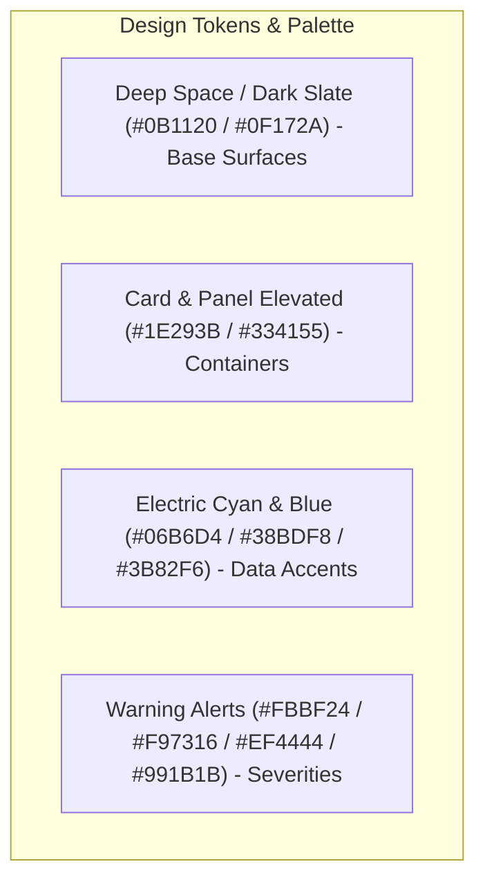
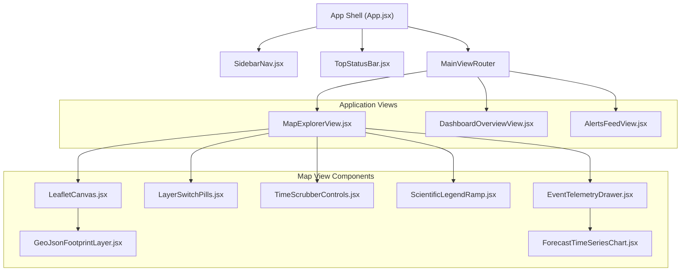

# AeroNex: Frontend UI/UX Design Specification

[]()
[]()
[]()

This document defines the interface architecture, design tokens, component hierarchy, interactive workflows, and responsive behavior for the **AeroNex** meteorological intelligence web application.

---

## 1. Visual Direction & Aesthetic Philosophy

AeroNex is designed with a **mission-critical scientific command center** aesthetic. It prioritizes high data density, immediate visual hierarchy, accessible contrast ratios, and intuitive geospatial exploration.



### Color Palette Matrix

| Token Name | Hex Code | Purpose / Usage |
| :--- | :--- | :--- |
| `surface-base` | `#0B1120` | Root application background; deep oceanic navy. |
| `surface-elevated` | `#0F172A` | Sidebar, top header, and navigation container. |
| `surface-card` | `#1E293B` | Floating cards, modal dialogs, and drawer backdrops. |
| `border-subtle` | `#334155` | 1px border dividers separating views and panels. |
| `text-primary` | `#F8FAFC` | High-contrast heading and primary data readout typography. |
| `text-muted` | `#94A3B8` | Subtitles, parameter units, and metadata labels. |
| `accent-cyan` | `#06B6D4` | Primary brand accent, active toggles, and coordinate crosshairs. |
| `accent-sky` | `#38BDF8` | Wind velocity vectors, hover highlights, and active slider thumbs. |
| `severity-advisory` | `#FBBF24` | Level 1 anomaly polygon border & badge (Yellow). |
| `severity-moderate` | `#F97316` | Level 2 anomaly polygon border & badge (Orange). |
| `severity-severe` | `#EF4444` | Level 3 anomaly polygon border & badge (Red). |
| `severity-extreme` | `#991B1B` | Level 4 anomaly polygon border & badge (Crimson). |

### Typography System
* **Primary Sans-Serif**: `Inter`, system-ui (Weights: 400 Regular, 500 Medium, 600 Semi-Bold, 700 Bold).
* **Monospace Data Font**: `JetBrains Mono`, monospace (Coordinates, timestamps, numeric weather readouts, $Z$-scores).

---

## 2. Layout Structure & Wireframe

The application employs a 3-zone desktop layout:

```text
+-------------------------------------------------------------------------------------------------------+
|  AERONEX [Logo]  |  Region: Bay of Bengal  |  Mode: DEMO_SYNTHETIC [Badge]  |  UTC: 2026-09-26 00:00Z  |
+---------+-------------------------------------------------------------+-------------------------------+
|         |                                                             | [Overview / Details Drawer]   |
| [Nav]   |  [MAP VIEWPORT (Leaflet Canvas)]                            |                               |
|         |                                                             |  KPI STATS CARDS              |
| (•) Map |  +-------------------------------------------------------+  |  - Active Anomalies: 4        |
| [=] Dash|  | [Layer Toggles: (T2M) | [WIND] | (MSLP)]             |  |  - Severe Events: 2           |
| [/] Warn|  +-------------------------------------------------------+  |                               |
| [?] Help|                                                             |  ACTIVE ANOMALY DETAILS       |
|         |  * GeoJSON Footprints with Severity Glow                     |  Event: CYC-202410-001        |
|         |  * Center Coordinate Crosshair                              |  Severity: EXTREME            |
|         |  * Click-to-inspect Tooltip                                 |  Max Wind: 38.2 m/s           |
|         |                                                             |  Min MSLP: 974 hPa            |
|         |  +-------------------------------------------------------+  |                               |
|         |  | [TIME SCRUBBER: |<  <<  [►]  >>  >|  Step: T+48h]    |  |  FORECAST CHART (Recharts)    |
|         |  +-------------------------------------------------------+  |  [~~~ Uncertainty Envelope ~] |
+---------+-------------------------------------------------------------+-------------------------------+
```

### 1. Persistent Left Sidebar (Icon + Label Dock)
* **Branding**: Compact AeroNex geometric icon.
* **Navigation Items**:
  * `Overview Dashboard` (`LayoutDashboard` icon)
  * `Interactive Map` (`Map` icon)
  * `Anomaly & Alerts List` (`AlertTriangle` icon)
  * `Forecast Explorer` (`TrendingUp` icon)
  * `System Diagnostics` (`Activity` icon)
* **Collapse Behavior**: Shrinks to a 64px icon rail on medium screens to maximize map surface.

### 2. Top Status Bar
* **Regional Selector**: Dropdown to fly the map to predefined sectors (`Bay of Bengal`, `Northern Plains`, `Arabian Sea`).
* **Active Horizon Indicator**: Lead time indicator (e.g., `Day 2 / T+48h Valid: 2026-09-28`).
* **Data Provenance Tag**: Prominent colored pill (`DEMO_SYNTHETIC` in Amber or `LIVE_GFS` in Emerald).
* **Clock**: Real-time UTC clock.

### 3. Central Map Viewport
* **Base Tiles**: Dark matter CartoDB basemap with high-contrast coastlines and country borders.
* **Vector Overlays**: Leaflet GeoJSON layer rendering anomaly polygon perimeters with animated pulsing borders for `EXTREME` severity.
* **Floating Layer Switcher**: Pill-bar in the top-right corner to toggle between `Temperature (°C)`, `Wind Speed (m/s)`, and `Pressure (hPa)`.
* **Point Inspection Popover**: Clicking any point renders a glassmorphic tooltip with interpolated variables and $Z$-score.

### 4. Interactive Bottom Time Scrubber
* **Controls**:
  * Play / Pause toggle for automatic forecast time-lapse.
  * Step Back (`-24h`), Step Forward (`+24h`).
  * Continuous scrubbable range slider spanning $0h$ to $240h$ (Day 0 to Day 10).
  * Color-coded uncertainty bar beneath the slider (Green = Days 1–3, Yellow = Days 4–6, Red/Dashed = Days 7–10).

### 5. Right Collapsible Telemetry & Analytics Drawer
* **Top Section**: High-level KPI metric cards.
* **Middle Section**: Selected event diagnostic readout with rapid zoom-to-extent button.
* **Bottom Section**: Recharts 10-day time-series graph with shaded 10th–90th percentile uncertainty band.

---

## 3. UI Component Hierarchy



---

## 4. UI States & Interaction Guidelines

| State | Visual Treatment | User Action / Trigger |
| :--- | :--- | :--- |
| **Initial Loading** | Subtle pulsing skeleton cards on telemetry drawer; spinner over map canvas. | App boot or region change. |
| **Active Playback** | Time scrubber auto-advances step-by-step every 1.5 seconds; footprints glide smoothly across map. | Clicking "Play" (`Spacebar`). |
| **Polygon Hover** | Polygon stroke width expands from $2px$ to $4px$; glowing outer halo; quick tooltip appears. | Cursor mouseover on vector footprint. |
| **Polygon Click** | Map smoothly animates (`flyToBounds`) to the event bounding box; telemetry drawer slides open. | User clicks anomaly polygon. |
| **Data Error / Disconnect** | Red toast alert in bottom-right: "Backend API offline. Retrying in 5s..."; cached data remains visible. | FastAPI server unreachable. |
| **Empty State** | Map displays clear weather basemap with banner: "No anomalies detected exceeding selected threshold." | Filtering with extreme threshold. |

---

## 5. Responsive Behavior Across Viewports

* **Desktop ($\ge 1280px$)**: Full 3-column split view (Sidebar + Map Viewport + Telemetry Drawer).
* **Laptop / Tablet Landscape ($1024px - 1279px$)**: Telemetry drawer collapses into a floating drawer toggled via a floating action button (FAB).
* **Tablet Portrait ($768px - 1023px$)**: Map viewport takes 60% height; bottom tab panel takes 40% height.
* **Mobile ($< 768px$)**: Bottom navigation bar replaces sidebar; tab switcher toggles between full-screen Map View and full-screen Telemetry Cards.

---

## 6. Phase 6 Temporal Tracking & Uncertainty UI Additions

| Component | Visual Placement | Key Features & Interactions |
| :--- | :--- | :--- |
| **EventDetailModal (Multi-Tab)** | Modal overlay on event click | 3-tab layout: **Overview & Telemetry**, **Track Evolution** (step history table with speed, bearing, area changes, missing status), and **Forecast Uncertainty** (5-member ensemble spread vs deterministic Lyapunov decay guide). |
| **EventDetails Summary Strip** | Bottom of EventDetails panel | Direct track badge (`TRK-CYC-001 • 10.9 km/h NW • Net 1,042 km`) linking to full trajectory history. |
| **ForecastView Track Explorer** | Dedicated section in ForecastView | Track selector buttons (`TRK-CYC-001`, `TRK-HEAT-002`, `TRK-COLD-003`), metric cards, and dataset mode toggle (`Deterministic GFS` vs `5-Member Ensemble Demo`). |
| **Map Trajectory Waypoints** | Leaflet canvas overlay | Numbered waypoint circles along forecast trajectory (Day 1, Day 2, Day 3...) with hover tooltips displaying coordinates and displacement. |
| **Lead-Time Confidence Cues** | Map & timeline | Days 7–10 rendered with dashed borders and lower opacity to intuitively communicate atmospheric uncertainty decay. |

