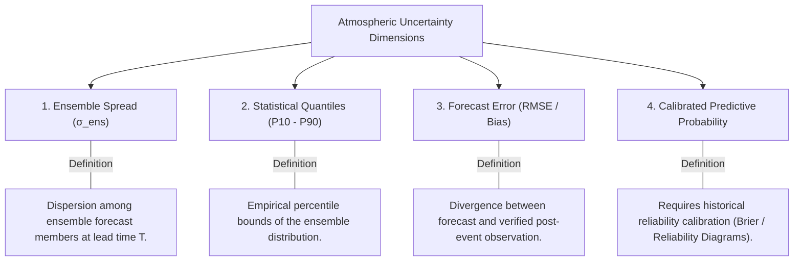

# AeroNex: Forecast Uncertainty & Multi-Horizon Dispersion Methodology

[]()
[]()
[]()

This document formalizes the scientific methodology for quantifying, aggregating, and displaying **forecast uncertainty** across multi-horizon numerical weather predictions in AeroNex.

---

## 1. Scientific Taxonomy of Uncertainty

Meteorological uncertainty is frequently conflated in software interfaces. AeroNex enforces strict scientific boundaries:



> [!IMPORTANT]
> **Fundamental Meteorological Truth**:
> * **Spread is NOT Error**: Ensemble spread quantifies model sensitivity to perturbed initial conditions. High spread indicates low predictability, but low spread (ensemble clustering) can occasionally exhibit collective "ensemble bust" where all members miss a rapid cyclogenesis event.
> * **Spread is NOT Calibrated Probability**: Raw ensemble fractions cannot be presented as true risk probabilities without post-processing calibration (e.g., Nonhomogeneous Gaussian Regression or Isotonic Regression).

---

## 2. Multi-Member Ensemble Descriptive Statistics

When multi-member ensemble forecasts are ingested (e.g. NOAA GEFS 31-member or synthetic demonstration scenarios), `app.ml.uncertainty.ForecastUncertaintyService` computes rigorous descriptive statistics:

### 2.1 Ensemble Mean ($\mu_{ens}$)
For $M$ valid numerical members $x_1, x_2, \dots, x_M$ at lead time $T$:
$$\mu_{ens}(T) = \frac{1}{M} \sum_{m=1}^M x_m(T)$$

### 2.2 Unbiased Ensemble Standard Deviation ($\sigma_{ens}$)
Measures spatial or parameter dispersion:
$$\sigma_{ens}(T) = \sqrt{\frac{1}{M - 1} \sum_{m=1}^M \left(x_m(T) - \mu_{ens}(T)\right)^2} \quad (M \ge 2)$$

### 2.3 Non-Parametric Quantile Dispersion
To prevent assumptions of Gaussian symmetry (which fail during skewed convective rainfall or cyclone wind extremes), AeroNex calculates empirical quantiles:
* $P_{10}$: 10th percentile (lower plausible bound)
* $P_{25}$: 25th percentile (lower quartile)
* $P_{50}$: 50th percentile (ensemble median)
* $P_{75}$: 75th percentile (upper quartile)
* $P_{90}$: 90th percentile (upper extreme bound)
* **Interquartile Range (IQR)**: $\text{IQR} = P_{75} - P_{25}$

### 2.4 Missing-Member Handling
When ensemble members drop out due to numerical divergence or communication dropouts:
$$\text{MissingFraction} = 1.0 - \frac{M_{valid}}{M_{expected}}$$
If $\text{MissingFraction} > 0.4$, uncertainty estimates are flagged with a data quality warning.

---

## 3. Atmospheric Error Growth & Lead-Time Skill Decay

Because atmospheric dynamics are governed by non-linear Navier-Stokes equations, initial state errors grow exponentially (Lyapunov timescale $\sim 3\text{--}5\text{ days}$):

| Lead Window | Forecast Hours | Synoptic Skill | Typical Error Growth Dynamics |
| :--- | :---: | :---: | :--- |
| **Days 1–3** | $0\text{h} \to 72\text{h}$ | **High** ($82\% - 95\%$) | Linear error growth. High track and intensity confidence. Tight ensemble consensus. |
| **Days 4–6** | $72\text{h} \to 144\text{h}$ | **Moderate** ($52\% - 72\%$) | Non-linear bifurcation begins. Track dispersion expands; convective timing shifts. |
| **Days 7–10** | $144\text{h} \to 240\text{h}$ | **Low / Trend-Only** ($22\% - 42\%$) | Chaotic saturation. Reliable for broad synoptic patterns only; specific centroid coordinates are unconstrained. |

---

## 4. Deterministic Unavailable State Protocol

When the active data pipeline processes a single deterministic NWP run (such as the operational NOAA GFS 0.25° run):
1. **Zero Fabrication Invariant**: The system **never** fabricates fake ensemble members from a deterministic forecast.
2. **Explicit Unavailable Response**: The `/api/uncertainty/series` endpoint returns:
   ```json
   {
     "is_available": false,
     "uncertainty_mode": "DETERMINISTIC_ONLY",
     "member_count": 1,
     "empty_state_explanation": "No multi-member ensemble forecast is configured for this variable. The active data originates from a single deterministic model run."
   }
   ```
3. **Explanatory UI Empty State**: Rather than displaying misleading zeros, the frontend displays an informative banner detailing synoptic skill decay guidelines.

---

## 5. Synthetic Demonstration Scenarios

To demonstrate the full capability of multi-member ensemble analytics in testing and hackathon evaluations, AeroNex includes:
* **Scenario 5: 5-Member Perturbed Cyclone Track**: Reproducible synthetic ensemble demonstrating member agreement decay from $100\%$ (Day 1) to $60\%$ (Day 5), with expanding spatial dispersion from $\pm 14.2\text{ km}$ to $\pm 142.1\text{ km}$.
* **Labeling**: All synthetic scenarios are tagged with `data_provenance: "SYNTHETIC_ENSEMBLE_DEMO"` and `is_simulated: true`.
